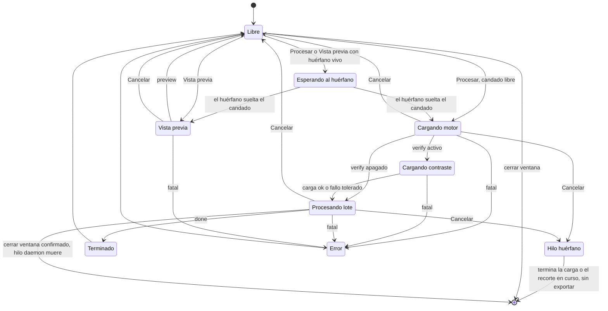
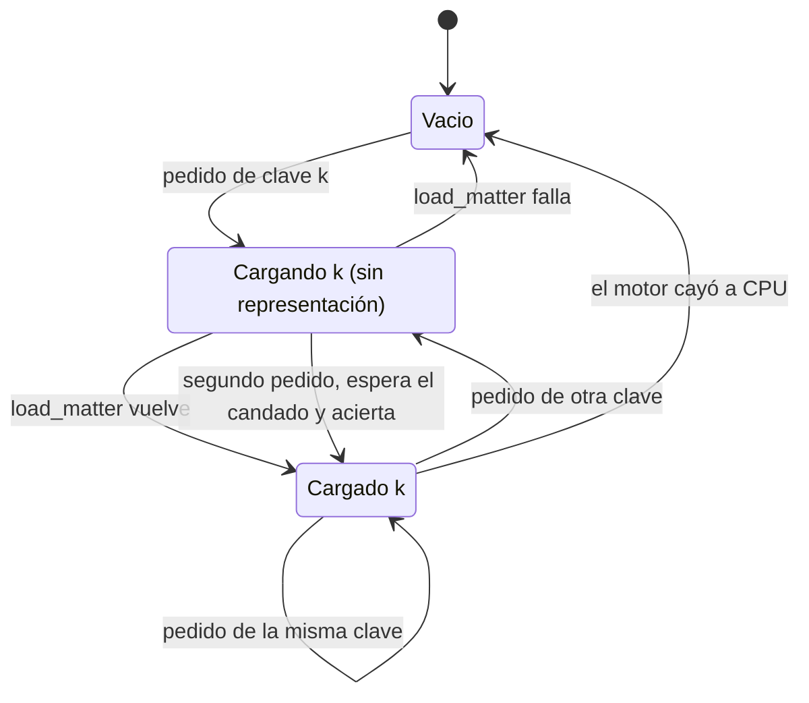
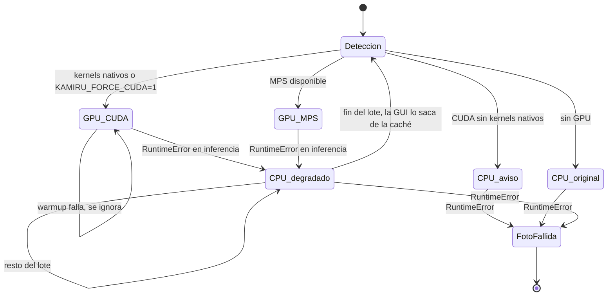
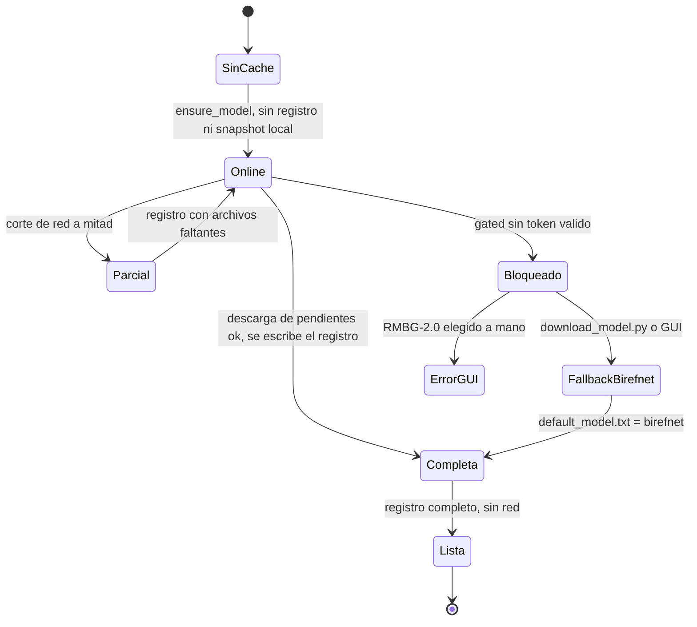
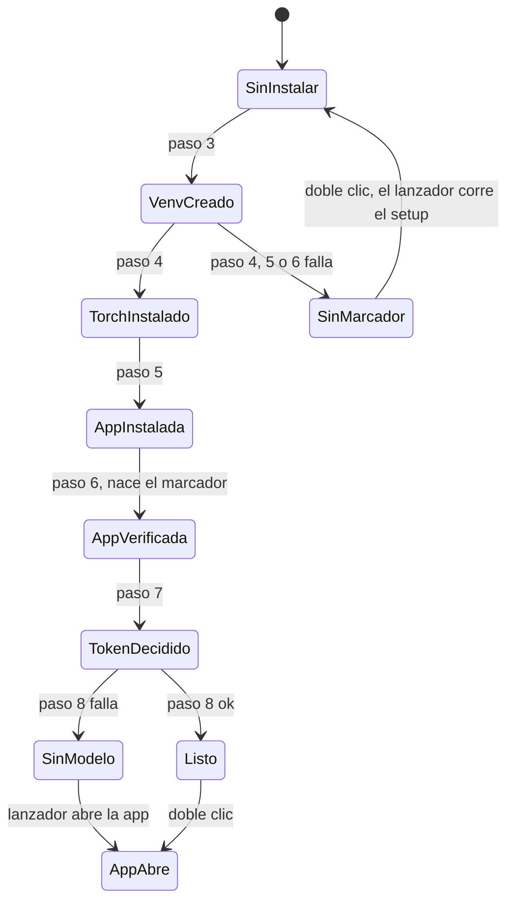
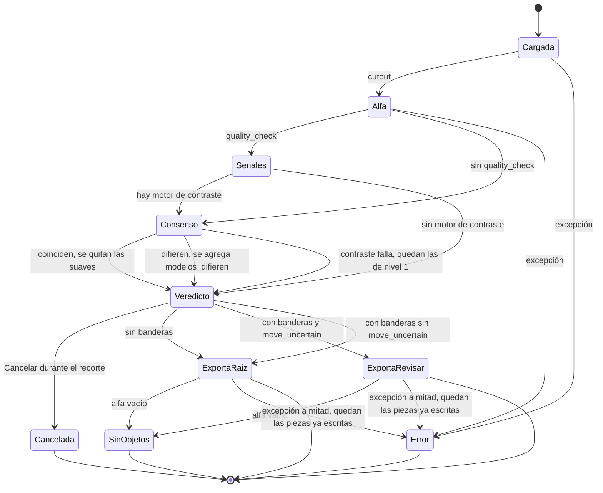
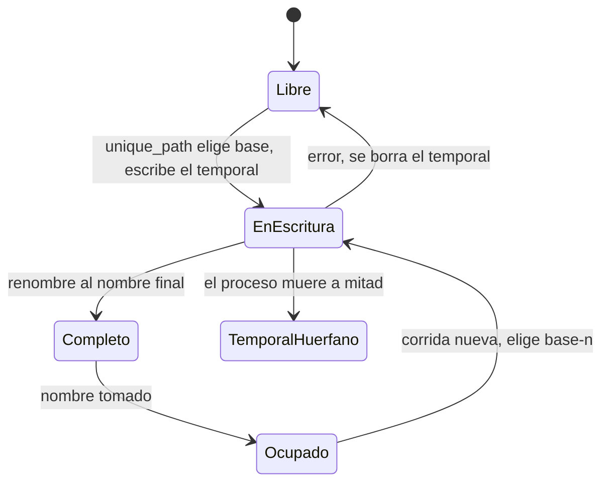
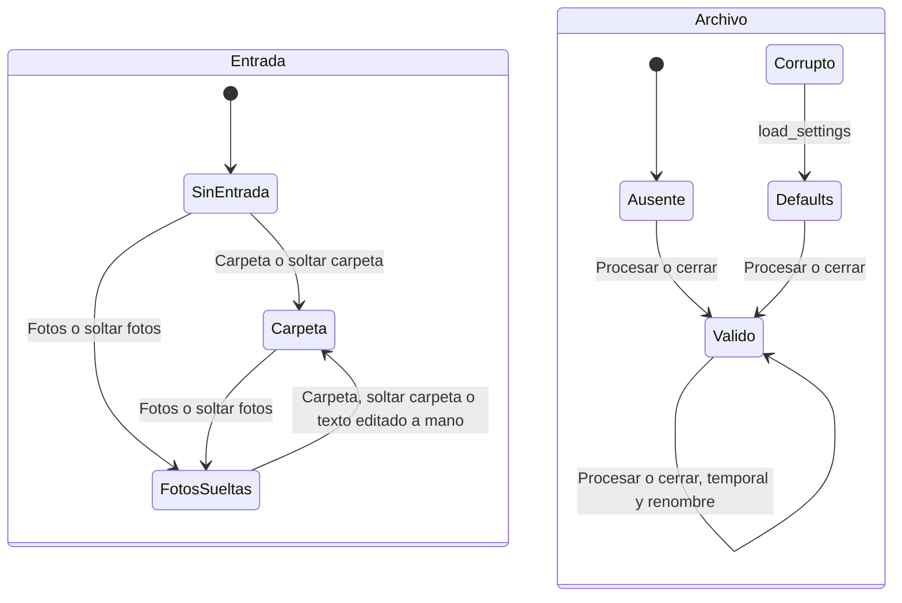
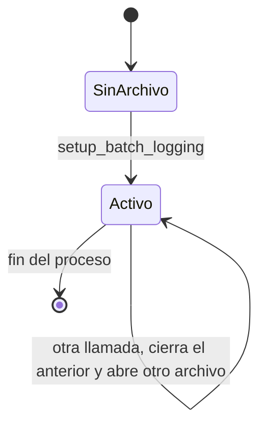
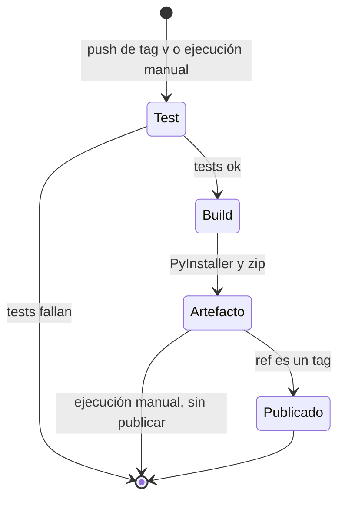

# Máquinas de estado implícitas en Kamiru

## Introducción

**Qué cuenta como máquina de estado implícita.** Es una parte del código donde
una entidad pasa por un conjunto finito de estados a lo largo del tiempo. El
código no tiene un tipo cerrado para esos estados ni una función única de
transición. El estado vive en otra forma: un entero, un `threading.Event`, un
campo que puede valer `None`, la presencia de un archivo, el texto de un widget
o el orden de los pasos de un script.

**Cómo se buscó.** Primero se leyeron `README.md` y `GUIA_KAMILA.md`. Después
se leyó entero cada módulo de `src/kamiru/`, los scripts de `scripts/`, los
lanzadores `Kamiru.bat` y `Kamiru.command`, los dos scripts de instalación,
`packaging/` y los dos workflows de `.github/workflows/`. Con grep se buscaron
escrituras y borrados de archivos (`write_text`, `open(`, `unlink`, `rename`,
`rmtree`), comprobaciones de existencia (`exists`, `is_dir`, `if not exist`),
banderas booleanas, campos opcionales, contadores, `Event`, colas y bucles con
`break`. En la versión revisada, el repositorio no tenía ningún borrado,
renombre ni bloqueo de archivos.

**Alcance.** La revisión se hizo sobre la versión 1.2.0, commit `66e9cd3`. No
se ejecutó la app y no se descargaron modelos. Después se arreglaron los
riesgos marcados como **Arreglado**. Las referencias `ruta:línea` de este
documento apuntan al código con esos arreglos (commit `6e4a6d2`). Un riesgo
arreglado describe en pasado el comportamiento anterior.

**Marcas de los riesgos.**

- **verificado**: se leyó el camino de código que lo prueba.
- **hipótesis**: depende de una librería externa, de un orden de tiempos o de
  un comportamiento que no se ejecutó.
- **Arreglado**: el commit citado cambia el código. Los scripts `.bat` y
  `.command` no se pudieron ejecutar en el entorno de los arreglos.

## Resumen

| # | Máquina | Codificación del estado | Archivo principal | Riesgo principal | Estado |
|---|---|---|---|---|---|
| 1 | Trabajo de la GUI | `_job_gen`, `_cancel`, `_engine_lock`, `_busy_since`, estado de botones, mensajes etiquetados en la cola | `src/kamiru/gui/app.py` | Tras Cancelar, el hilo huérfano seguía exportando y compartía el modelo con el trabajo nuevo. | Arreglado (`9dd4b72`, `eb0bd5f`) |
| 2 | Caché de motores de la GUI | `_matter`/`_matter_key`, `_verifier`/`_verifier_key` | `src/kamiru/gui/app.py` | Cancelar y Procesar durante la carga cargaban el modelo dos veces. | Arreglado (`9dd4b72`) |
| 3 | Dispositivo y caída a CPU | `DeviceInfo.kind`, `_device`/`_half` y `fell_back_to_cpu` dentro del motor | `src/kamiru/core/device.py`, `src/kamiru/core/matting.py` | Un solo `RuntimeError` en GPU dejaba el motor en CPU por el resto de la sesión, sin aviso en la UI. | Arreglado (`22f5787`) |
| 4 | Provisión y carga del modelo | caché HF en `models/`, registro propio del snapshot, `hf_token.txt`, `default_model.txt`, campo `model` de `settings.json` | `src/kamiru/core/model_fetch.py`, `scripts/download_model.py` | El modo offline nunca encontraba el modelo. Había dos fuentes de verdad para el modelo por defecto. | Arreglado (`86777e2`, `bac56df`) |
| 5 | Instalación y arranque | marcador `venv/kamiru_instalado.txt` y orden de pasos de los scripts | `setup_windows.bat`, `Kamiru.bat` | El marcador de "instalado" aparecía antes de que la instalación terminara. | Arreglado (`f056505`) |
| 6 | Destino de cada foto | `ImageReport.ok/review/outputs/error`, `QualityFlag.soft`, `consensus_iou` | `src/kamiru/core/pipeline.py`, `src/kamiru/core/quality.py` | Una foto salía como confiable sin consenso y el resumen no lo decía. | Arreglado (`eb0bd5f`, `9dd4b72`) |
| 7 | Carpeta de salida | existencia de archivos con sufijo `-n`; temporales `.nombre.part` | `src/kamiru/core/export.py` | Escritura directa a la ruta final: archivos truncados con nombre válido. | Arreglado (`eb0bd5f`); sin reanudación |
| 8 | Configuración y entrada de la GUI | `settings.json`, par `dropped_files` + `input_dir`, par `chroma_auto` + `chroma_color` | `src/kamiru/settings.py`, `src/kamiru/gui/app.py` | La lista de fotos sueltas ganaba en silencio sobre la ruta escrita a mano. | Arreglado (`36b2560`) |
| 9 | Log de corrida | lista de handlers del logger `kamiru` | `src/kamiru/core/pipeline.py` | Varias corridas en un mismo proceso duplicaban líneas entre archivos de log. | Arreglado (`ee3749b`) |
| 10 | Build y release | carpetas `build-env/` y `dist/`, presencia de `nvidia-smi` | `packaging/build_release.bat` | El zip con CUDA y el zip con CPU llevaban el mismo nombre. | Arreglado (`4968d67`) |

---

## 1. Ciclo de vida de un trabajo en la GUI

**Propósito.** Llevar la ventana de "Lista" a "ocupada" y de vuelta, para un
lote o para una vista previa, con cancelación inmediata.

**Dónde.**

- Campos de estado: `src/kamiru/gui/app.py:80-94`.
- `_begin_job`: `src/kamiru/gui/app.py:471-484`. `_end_job`: `src/kamiru/gui/app.py:486-491`. `_is_stale`: `src/kamiru/gui/app.py:493-494`. `_exclusive`: `src/kamiru/gui/app.py:496-511`.
- `_start` y su hilo: `src/kamiru/gui/app.py:513-572`.
- `_preview` y su hilo: `src/kamiru/gui/app.py:574-607`.
- `_cancel_run`: `src/kamiru/gui/app.py:638-646`.
- `_poll_queue`, con el filtro por generación: `src/kamiru/gui/app.py:649-712` (filtro en 673-675).
- Bucle del lote y puntos de corte: `src/kamiru/core/pipeline.py:293-318` (corte al inicio de la vuelta en 294-296; corte antes de exportar en 209-210, capturado en 307-310).
- Cierre de la ventana: `src/kamiru/gui/app.py:99` y `src/kamiru/gui/app.py:315-321`.

**Cómo se codifica.** No hay un campo de estado. El estado es la combinación de:

- `_job_gen` (entero): identifica el trabajo vigente.
- `_cancel` (`threading.Event`): pedido de corte.
- `_engine_lock` (`threading.Lock`): lo tiene el hilo que usa los motores.
- `_busy_since` (`float` o `None`): `None` significa libre.
- el estado de los botones Procesar, Vista previa y Cancelar.
- el hilo de trabajo. Para el lote se guarda en `_worker` (`app.py:570`), pero
  ningún código lee ese campo. Para la vista previa no se guarda (`app.py:607`).
- los mensajes de la cola. `status`, `progress`, `preview`, `done` y `fatal`
  llevan la generación. `device`, `device_error` y `model` no la llevan.
- dentro del hilo, la fase depende del punto del código donde está el hilo:
  espera del candado, carga del motor, carga del motor de contraste o lote.

**Estados.**

- Libre.
- Esperando al huérfano: el trabajo nuevo espera el candado.
- Cargando motor.
- Cargando motor de contraste.
- Procesando lote.
- Vista previa en curso.
- Terminado (libre, con resumen).
- Error (libre, con diálogo).
- Huérfano: hilo viejo vivo mientras la UI ya está libre. Puede coexistir con
  cualquier otro estado. Mientras vive, tiene el candado.

**Transiciones.**

| Desde | Hacia | Disparador | Código |
|---|---|---|---|
| Libre | Cargando motor | Procesar con entrada y salida válidas, candado libre | `app.py:513-527`, `_begin_job` en 475-483, candado en 503 |
| Libre | Esperando al huérfano | Procesar o Vista previa con un huérfano vivo | `app.py:503-506` |
| Esperando al huérfano | Cargando motor | el huérfano suelta el candado | `app.py:506-509` |
| Libre | Vista previa | Vista previa con al menos una foto | `app.py:574-587` |
| Cargando motor | Cargando contraste | `spec["verify"]` verdadero | `app.py:536-538` |
| Cargando contraste | Procesando lote | carga correcta, o fallo capturado con aviso | `app.py:539-548` |
| Cargando | Procesando lote | `_is_stale(gen)` falso | `app.py:549-551` |
| Procesando lote | Terminado | mensaje `done` con generación vigente | `app.py:687-699` |
| Vista previa | Libre | mensaje `preview` | `app.py:683-686` |
| Cualquier fase del hilo | Error | excepción en el hilo, mensaje `fatal` | `app.py:566-568`, `603-605`, `700-708` |
| Cualquier fase ocupada | Libre + Huérfano | Cancelar: pone `_cancel`, incrementa `_job_gen`, libera botones | `app.py:641-643` |
| Huérfano en carga | fin del hilo | la carga termina, el motor queda en caché, se suelta el candado | `app.py:412`, `549-550`, `594-595`, `510-511` |
| Huérfano en lote | fin del hilo | termina el recorte de la foto en curso, no la exporta y corta | `pipeline.py:209-210`, `307-310` |
| Cualquiera | proceso terminado | cerrar la ventana; con un trabajo en curso pide confirmación; los hilos son `daemon` | `app.py:315-321`, `570-571`, `607` |

**Invariantes.**

- **I1.1. La UI solo reacciona a mensajes del trabajo vigente.** Se cumple. El
  filtro está en `app.py:673-675`. `_is_stale` compara la generación además del
  `Event` (`app.py:494`). Por eso el `self._cancel.clear()` de un trabajo nuevo
  (`app.py:477`) no revive al huérfano. Este mecanismo es sólido.
- **I1.2. Las variables Tk se leen solo en el hilo principal.** Se cumple.
  `_matter_spec` (`app.py:357-369`) y `_validated_options`
  (`app.py:456-469`) corren antes de lanzar el hilo. El hilo recibe valores
  planos.
- **I1.3. Un solo trabajo usa el motor a la vez.** Se cumple desde `9dd4b72`.
  Cada hilo de trabajo corre dentro de `_exclusive` (`app.py:496-511`) y toma
  `_engine_lock` antes de usar los motores.
- **I1.4. Todo trabajo deja la UI libre al terminar.** Se cumple para `done`,
  `fatal`, `preview` y Cancelar. Si el hilo muere por una excepción que no
  hereda de `Exception`, la UI queda ocupada hasta Cancelar. Es una hipótesis de
  bajo impacto, y Cancelar la resuelve.

**Riesgos.**

- **R1.1 (verificado). El hilo huérfano corría en paralelo con el trabajo
  nuevo.** Tras Cancelar durante un lote, el huérfano terminaba la foto en
  curso y la exportaba. La comprobación de corte estaba solo al inicio de cada
  vuelta, y `process_image` corría entero. Si la persona apretaba Procesar
  enseguida, dos hilos llamaban `cutout` sobre el mismo objeto `self._matter`.
  En GPU eso duplicaba la memoria de activaciones. Si uno de los dos hilos
  disparaba la caída a CPU (máquina 3), el otro hilo podía tener tensores en el
  dispositivo viejo (hipótesis).
  **Arreglado** (commits `9dd4b72` y `eb0bd5f`): el trabajo nuevo espera el
  candado `_engine_lock`, y el huérfano comprueba Cancelar antes de exportar
  (`pipeline.py:209-210`), así que ya no exporta la foto en curso.
- **R1.2 (verificado). El resumen de un lote cancelado se pierde.**
  `run_batch` devuelve un `BatchSummary` también cuando corta
  (`pipeline.py:296`, `310`, `320`). El mensaje `done` del huérfano llega con
  una generación vieja y la UI lo descarta (`app.py:674-675`). Los archivos ya
  exportados quedan en disco y solo el log los registra. Sin cambios: mostrar
  un resumen tras Cancelar es una decisión de producto.
- **R1.3 (verificado). Cerrar la ventana durante un lote no pedía
  confirmación.** `_on_close` guardaba la configuración y destruía la ventana.
  El hilo `daemon` moría cuando salía el intérprete. Si el hilo estaba
  escribiendo un archivo, el archivo quedaba truncado con su nombre final.
  **Arreglado** (commits `9dd4b72` y `eb0bd5f`): con un trabajo en curso,
  cerrar pide confirmación (`app.py:315-319`), y un corte deja solo un
  temporal `.nombre.part`.
- **R1.4 (hipótesis, de tiempos; se confirmó al ejecutar la GUI con motores
  falsos). El huérfano y el trabajo nuevo podían elegir el mismo nombre.** Los
  dos llamaban `unique_path` (`export.py:36-43`) sobre la misma carpeta.
  Comprobar y escribir son dos pasos separados. En la prueba, seis
  exportaciones dejaron cinco archivos.
  **Arreglado** (commit `9dd4b72`): con el candado hay un solo escritor por
  proceso.
- **R1.5 (verificado, bajo impacto). El mensaje `device` no lleva
  generación.** `import torch` tarda varios segundos (`app.py:230-239`). Si el
  mensaje llegaba después de empezar un trabajo, el aviso de dispositivo
  pisaba la línea de estado y el cuadro de resumen.
  **Arreglado** (commit `9dd4b72`): con un trabajo en curso, el mensaje solo
  cambia la etiqueta de dispositivo (`app.py:658-661`).
- **R1.6 (verificado, bajo impacto). "Abrir salida" queda habilitado para
  siempre** tras el primer `done` (`app.py:692`). `_open_output` comprueba la
  carpeta antes de abrirla (`app.py:303`), así que no falla. Sin cambios.

---

## 2. Caché de motores en la GUI

**Propósito.** Reusar el modelo cargado entre Procesar y Vista previa, y
aprovechar una carga que siguió de fondo tras Cancelar.

**Dónde.**

- Campos: `src/kamiru/gui/app.py:83-86`.
- Motor principal: `_build_matter`, `src/kamiru/gui/app.py:371-398`, y `_cached_matter`, `src/kamiru/gui/app.py:400-413` (acierto en 402-403, escritura en 412).
- Motor de contraste: `_build_verifier`, `src/kamiru/gui/app.py:415-439` (acierto en 430-431, escritura en 438).
- Croma, fuera de la caché: `src/kamiru/gui/app.py:374-378`.
- Motores que cayeron a CPU, fuera de la caché: `_drop_cpu_fallbacks`, `src/kamiru/gui/app.py:441-454`.

**Cómo se codifica.** Dos pares de campos opcionales, uno por rol:
`(_matter, _matter_key)` y `(_verifier, _verifier_key)`. La clave es
`(modelo, resolución)`. El motor croma no pasa por la caché: cada trabajo crea
un `ChromaMatter` nuevo. Todas las lecturas y escrituras de la caché ocurren
con `_engine_lock` tomado (máquina 1).

**Estados por rol.**

- Vacío: el objeto vale `None`.
- Cargado(clave).
- Cargando(clave). El código no representa este estado. Existe solo como un
  hilo que está dentro de `load_matter` y tiene el candado.

**Transiciones.**

- Vacío → Cargando(k): pedido de cualquier clave (`app.py:406`, `434`).
- Cargando(k) → Cargado(k): `load_matter` vuelve. La asignación ocurre aunque
  el trabajo esté cancelado (`app.py:410-412`, `438`).
- Cargando(k) → estado anterior: `load_matter` lanza una excepción.
- Cargado(k) → Cargado(k): acierto (`app.py:402-403`, `430-431`).
- Cargado(k) → Cargando(k2): pedido de otra clave. El motor viejo pierde su
  referencia cuando la carga nueva termina.
- Cargado(k) → Vacío: el motor cayó a CPU durante el trabajo (`app.py:441-454`).
- Un segundo pedido durante Cargando(k) espera el candado y después acierta.

**Invariantes.**

- **I2.1. El objeto en caché corresponde a su clave.** Se cumple. Objeto y
  clave se asignan en una sola tupla (`app.py:412`, `438`).
- **I2.2. La clave describe todo lo que cambia el resultado.** La clave no
  incluye el dispositivo. Antes, tras una caída a CPU (máquina 3) la caché
  servía un motor degradado. Desde `22f5787` ese motor sale de la caché al
  terminar el trabajo, así que la caché solo guarda motores en su dispositivo
  original.
- **I2.3. Hay una sola carga por clave.** Se cumple desde `9dd4b72` (R2.1).

**Riesgos.**

- **R2.1 (verificado). Doble carga.** La persona cancelaba durante la carga y
  apretaba Procesar antes de que la carga terminara. El hilo nuevo veía
  `_matter` en `None` y llamaba `load_matter` otra vez. Corrían dos cargas en
  paralelo: dos copias de los pesos en RAM y en VRAM, y dos descargas si el
  modelo no estaba en disco.
  **Arreglado** (commit `9dd4b72`): el hilo nuevo espera el candado y reusa el
  modelo que dejó la carga del huérfano. El README ya decía que "la carga sigue
  de fondo y se aprovecha en el próximo Procesar", y ahora vale siempre.
- **R2.2 (verificado). Ganaba la última escritura.** Si el huérfano cargaba la
  clave A y el trabajo nuevo la clave B, la caché guardaba la que terminaba
  última.
  **Arreglado** (commit `9dd4b72`): las cargas van en serie. La caché queda con
  la clave del pedido más reciente.
- **R2.3 (verificado). No hay caché de fallos para el contraste.** Si el motor
  de contraste no carga, `_verifier` queda en `None` y cada Procesar reintenta
  la carga. Con una red que no responde, cada intento puede esperar hasta
  `NETWORK_TIMEOUT` = 30 s (`model_fetch.py:30`, `113`). Sin cambios: el
  reintento sirve si la red vuelve, y elegir entre reintentar o recordar el
  fallo es una decisión de producto. Desde `9dd4b72` el resumen dice que el
  lote no tuvo contraste.
- **R2.4 (verificado, bajo impacto). Los dos motores quedan en memoria hasta
  cerrar la app.** Es una decisión válida para el reuso. Con resolución 2048 la
  VRAM puede agotarse, y eso lleva a R3.1. Sin cambios.

---

## 3. Dispositivo de cómputo y caída de GPU a CPU

**Propósito.** Elegir CUDA, MPS o CPU al cargar el motor, y pasar a CPU si una
inferencia falla en GPU.

**Dónde.**

- `arch_status`: `src/kamiru/core/device.py:23-46`.
- `detect_device`: `src/kamiru/core/device.py:55-80` (`KAMIRU_FORCE_CUDA` en 62-63).
- Detección al crear el motor: `src/kamiru/core/matting.py:131`.
- Tipo numérico y movimiento a dispositivo: `src/kamiru/core/matting.py:165-175`.
- Warmup: `src/kamiru/core/matting.py:177-190`.
- Inferencia con caída: `src/kamiru/core/matting.py:206-225` (mutación en 219-222).
- Marca de caída: `BaseMatter.fell_back_to_cpu`, `src/kamiru/core/matting.py:101`.
- Etiqueta de dispositivo en la GUI: `src/kamiru/gui/app.py:230-239`, `654-662`, `482-483` y `690-691`.
- Aviso tras el lote: GUI en `src/kamiru/gui/app.py:559-565`; CLI en `src/kamiru/cli.py:141-144`.

**Cómo se codifica.** La elección inicial es un `DeviceInfo` con `kind` en
`"cuda" | "mps" | "cpu"` y un `warning` opcional. Después, el estado real del
motor son cuatro valores mutables: `self._device`, `self._half`,
`self.fell_back_to_cpu` y el dispositivo de los pesos de `self.model`.
`self.device_info.kind` no cambia nunca, ni siquiera tras la caída.

**Estados.**

- Detección: CUDA nativa; CUDA forzada; CUDA sin kernels nativos (pasa a CPU
  con aviso); MPS; CPU sin GPU.
- Ejecución: GPU (fp16 en CUDA, fp32 en MPS); CPU original; CPU degradado
  (llegó por caída, `fell_back_to_cpu` verdadero).

**Transiciones.**

- `arch_status` da `"native"`, o `KAMIRU_FORCE_CUDA` vale `1`, `true`, `yes`
  o `si` → CUDA (`device.py:62-64`).
- CUDA disponible sin kernels nativos (`"jit"` o `"unsupported"`) → CPU con
  aviso (`device.py:65-77`).
- MPS disponible → MPS (`device.py:78-79`). Ninguna GPU → CPU (`device.py:80`).
- El warmup falla → se registra y el motor sigue en GPU (`matting.py:189-190`).
- `_device` en GPU y `RuntimeError` en `_forward` → mueve los pesos a CPU,
  fija `_device`, `_half` y `fell_back_to_cpu`, y reintenta una vez
  (`matting.py:212-223`).
- `_device` en CPU y `RuntimeError` → la foto falla (`matting.py:225`).
- Fin del trabajo en la GUI con `fell_back_to_cpu` → el motor sale de la caché,
  la etiqueta y el resumen lo avisan (`app.py:559-565`, `690-691`). El trabajo
  siguiente carga el motor otra vez en la GPU.

**Invariantes.**

- **I3.1. `_half` es verdadero solo con pesos en CUDA.** Se cumple
  (`matting.py:166-168`, `221`).
- **I3.2. Tensor de entrada y pesos están en el mismo dispositivo.** Se cumple
  porque `_preprocess` lee `self._device` en cada llamada (`matting.py:201`) y,
  desde `9dd4b72`, un solo hilo usa el motor a la vez.
- **I3.3. La UI muestra el dispositivo real.** Se cumple al final de cada
  trabajo desde `22f5787`. Durante el lote en que ocurre la caída, la etiqueta
  sigue diciendo GPU hasta el mensaje `done`.

**Riesgos.**

- **R3.1 (verificado en el código; el tipo de excepción viene de PyTorch).
  Caída permanente y silenciosa.** Cualquier `RuntimeError` en GPU llevaba el
  motor a CPU. Eso incluye `torch.cuda.OutOfMemoryError`, que hereda de
  `RuntimeError`: por ejemplo una foto a 2048 con dos motores en VRAM. No había
  vuelta a GPU. La caché de la GUI seguía sirviendo ese motor hasta cerrar la
  app. El único rastro era un `log.warning`, y la etiqueta seguía diciendo "GPU
  NVIDIA".
  **Arreglado** (commit `22f5787`): el motor marca `fell_back_to_cpu`; al
  terminar el lote la GUI lo saca de la caché, cambia la etiqueta y lo dice en
  el resumen, y la CLI también lo avisa. La caída sigue valiendo para el resto
  de ese lote. `OutOfMemoryError` no tiene un trato aparte.
- **R3.2 (verificado). El comentario y el código decían cosas distintas.** El
  comentario hablaba solo de ops no soportadas en MPS, y el código aplicaba la
  caída a cualquier GPU.
  **Arreglado** (commit `22f5787`): el comentario nombra MPS y CUDA
  (`matting.py:214-216`). La condición usa el dispositivo real (`_device`), así
  que un fallo ya en CPU falla la foto en vez de repetir la caída.
- **R3.3 (verificado). `KAMIRU_FORCE_CUDA=0` también forzaba la GPU.** La
  condición solo miraba que la variable tuviera texto.
  **Arreglado** (commit `22f5787`): solo `1`, `true`, `yes`, `si` o `sí`
  fuerzan la GPU (`device.py:62-63`).
- **R3.4 (verificado, bajo impacto). Un warmup fallido no cambia el estado**
  (`matting.py:189-190`). La primera foto real probablemente repite el error y
  dispara R3.1. Esa última parte es una hipótesis sobre la causa del fallo. Sin
  cambios: desde `22f5787` esa caída queda a la vista.
- **Parte sólida.** `arch_status` es una función pura con tests
  (`tests/test_device_and_fetch.py:7-29`) y evita el cuelgue por compilación
  JIT de kernels.

---

## 4. Provisión y carga del modelo

**Propósito.** Tener los pesos en disco, con token o sin él, y decidir qué
modelo usa la app por defecto. La máquina cruza cuatro procesos distintos: el
script de setup, `scripts/download_model.py`, la GUI y la CLI.

**Dónde.**

- Token en el setup: `setup_windows.bat:78-88`, `setup_macos.command:64-74`.
- Descarga en el setup: `setup_windows.bat:93-97`, `setup_macos.command:79`.
- `scripts/download_model.py:33-64` (escritura de `default_model.txt` en 45 y 57).
- Registro propio del snapshot: `src/kamiru/core/model_fetch.py:41-76`.
- `ensure_model`: `src/kamiru/core/model_fetch.py:79-144` (offline en 93-107, online en 109-144).
- Rutas, token y archivo de modelo por defecto: `src/kamiru/paths.py:39-47`, `50-63`, `66-68`.
- `resolve_default_model`: `src/kamiru/core/matting.py:61-68`.
- Fases de carga: `src/kamiru/core/matting.py:142-191`.
- Elección del modelo: GUI en `src/kamiru/gui/app.py:66-67` y `323-345`; CLI en `src/kamiru/cli.py:48`.
- Caída a BiRefNet en la GUI: `src/kamiru/gui/app.py:379-398`.

**Cómo se codifica.** Con archivos y variables de entorno, sin un registro
central:

- la caché de HuggingFace bajo `models/` (`HF_HOME`, `paths.py:42`): vacía,
  parcial o completa.
- el registro de la app `models/kamiru-snapshot-<org>--<repo>.json`: hash del
  commit y lista de archivos de la última descarga completa.
- `models/hf_token.txt` o la variable `HF_TOKEN`: ausente, válido o inválido.
- `models/default_model.txt`: ausente, `rmbg-2.0` o `birefnet`.
- el campo `model` de `settings.json` (`settings.py:26`). Vacío significa
  "seguir `default_model.txt`". La GUI lo escribe en cada Procesar y al cerrar
  (`app.py:525`, `320`, `323-345`).
- las fases de carga de `NeuralMatter.__init__`, visibles solo como mensajes
  de progreso: resolver caché (`matting.py:146`), leer pesos (150-154), tipo
  numérico (166-171), mover a GPU (175), warmup (180-190), listo (191).

**Estados.**

- Por repositorio: SinCaché, Parcial, Completa.
- Por instalación: Listo con `rmbg-2.0`, Listo con `birefnet`, Bloqueado
  (repositorio gated sin acceso).

**Transiciones.**

- `ensure_model` con registro: si cada archivo del registro está en el
  snapshot, la ruta sale sin red (`model_fetch.py:94-98`). Si falta uno, pasa
  al camino online.
- `ensure_model` sin registro (caché de una versión anterior): intenta
  `snapshot_download(repo, local_files_only=True)` (`model_fetch.py:100-107`).
- Camino online: `model_info` con timeout (113), descarga de los archivos
  pendientes con `revision=info.sha` (133-138), registro nuevo (143) y ruta
  del snapshot (144).
- `download_model.py`: éxito → escribe la clave en `default_model.txt` (45).
  `GatedRepoError` o `HfHubHTTPError` → descarga `birefnet` y escribe
  `birefnet` (49-58). Otro error (red caída, timeout) → sale con traza.
- GUI: modelo = `settings.model` si es un modelo conocido, si no
  `resolve_default_model()` (`app.py:66-67`). Al guardar, el modelo por defecto
  se guarda vacío (`app.py:326-330`). CLI: siempre `resolve_default_model()`
  (`cli.py:48`).
- Carga con un error que contiene "gated" o "401" → `GatedModelError` con la
  ayuda `GATED_HELP` (`matting.py:155-160`). Otro error → se relanza (161).
- GUI y `GatedModelError` con RMBG-2.0 por defecto → carga `birefnet`, escribe
  `default_model.txt` y avisa en el resumen (`app.py:381-398`).

**Invariantes.**

- **I4.1. Con el modelo en caché, la carga no toca la red** (README, sección
  "Solución de problemas"). Se cumple desde `86777e2` para toda caché bajada
  con esta versión. Una caché de una versión anterior depende de que exista
  `refs/main`.
- **I4.2. `HF_HOME` se fija antes de importar `huggingface_hub`.** Se cumple
  por el orden de las llamadas: `matting.py:123` va antes de 125-126, y
  `download_model.py:38` va antes de 41. Ninguna guardia lo asegura. Un import
  futuro de `huggingface_hub` a nivel de módulo lo rompería.
- **I4.3. `default_model.txt` dice qué modelo usa la app.** Se cumple para la
  CLI. Se cumple para la GUI desde `bac56df`, salvo que se elija otro modelo a
  mano en "Avanzado".

**Riesgos.**

- **R4.1 (hipótesis, depende de `huggingface_hub`; confirmada). El camino
  offline no se activaba nunca en una instalación nueva.** `ensure_model`
  descarga con `revision=info.sha` (`model_fetch.py:136`, `141`). Con una
  revisión que ya es un hash de commit, `huggingface_hub` no escribe
  `refs/main` (`_cache_commit_hash_for_specific_revision`, leído en la versión
  2.4.0). A su vez, `snapshot_download` en modo local y sin revisión necesita
  `refs/main`. Cada carga pasaba por `model_info`, y sin internet la app
  fallaba aunque los pesos estuvieran en disco. Un test con la caché real de
  la librería lo reproducía.
  **Arreglado** (commit `86777e2`): tras una descarga completa la app guarda
  su propio registro del snapshot, y el camino offline lo usa sin depender de
  `refs/main`.
- **R4.2 (hipótesis, depende de `huggingface_hub`). Caché parcial sin
  salida.** Si `refs/main` existía y faltaban archivos del snapshot (descarga
  cortada), `snapshot_download` en modo local podía devolver la carpeta sin
  comprobar que estuviera completa. `from_pretrained` fallaba en cada Procesar.
  **Arreglado** (commit `86777e2`): con registro, el camino offline comprueba
  cada archivo con `try_to_load_from_cache` y, si falta uno, baja solo lo que
  falta. El test `TestEnsureModelRealCache`
  (`tests/test_device_and_fetch.py:102`) lo prueba con la caché real de la
  librería. Una caché de una versión anterior sin registro sigue con el camino
  viejo hasta la primera descarga con red.
- **R4.3 (verificado). Dos fuentes de verdad para el modelo por defecto.** La
  GUI usaba `settings.model` si tenía texto y lo guardaba en cada Procesar y al
  cerrar. Tras el primer cierre, `default_model.txt` ya no influía en la GUI.
  Caso concreto: el setup sin token dejaba `birefnet`; más tarde se pegaba el
  token y se corría `download_model.py`, y la GUI seguía con `birefnet`.
  **Arreglado** (commit `bac56df`): la GUI guarda el modelo vacío cuando
  coincide con el modelo por defecto (`app.py:326-330`). Un `settings.json`
  escrito por la versión anterior todavía guarda `birefnet`; ese caso se
  corrige eligiendo RMBG-2.0 una vez en "Avanzado".
- **R4.4 (verificado). El ejecutable empaquetado no tenía caída a
  `birefnet`.** El ejecutable no pasa por el setup. Sin `default_model.txt` el
  modelo es `rmbg-2.0` (`matting.py:64-68`). Sin token, el primer Procesar
  terminaba en `fatal` con la ayuda `GATED_HELP`.
  **Arreglado** (commit `bac56df`): si RMBG-2.0 llegó por defecto, la GUI carga
  `birefnet`, lo anota en `default_model.txt` y lo avisa en el resumen
  (`app.py:381-398`). Con RMBG-2.0 elegido a mano, el error con la ayuda se
  mantiene.
- **R4.5 (verificado). Un token inválido queda fijo.** El setup pide el token
  solo si `hf_token.txt` no existe (`setup_windows.bat:79`,
  `setup_macos.command:65`). Con un token mal pegado, cada corrida nueva del
  setup cae a `birefnet` sin volver a preguntar. Para corregirlo hay que editar
  o borrar el archivo a mano. Sin cambios: cambiar las preguntas del setup
  necesita una decisión y una prueba en Windows y macOS.
- **R4.6 (verificado). `download_model.py` captura solo errores HTTP de
  HuggingFace** (`download_model.py:49`). Un corte de red o un timeout sale
  como traza y no pasa a `birefnet`. Sin cambios: sin red, la descarga de
  `birefnet` también falla, y el setup ya muestra un mensaje de error.
- **R4.7 (verificado, bajo impacto). `HF_HOME` usa `setdefault`**
  (`paths.py:42`). Si el sistema ya define `HF_HOME`, los pesos van a la caché
  global. `models/` queda con el token, el modelo por defecto y el registro del
  snapshot. Sin cambios: respetar la variable del sistema es intencional.

---

## 5. Instalación y arranque

**Propósito.** Llevar una carpeta recién copiada a una app que abre con doble
clic. La máquina cruza tres procesos: lanzador, script de setup e intérprete de
la app.

**Dónde.**

- Lanzador Windows: `Kamiru.bat:4-10`. Lanzador macOS: `Kamiru.command:4-10`.
- Setup Windows: `setup_windows.bat:10-102` (marcador en 12-13 y 74-75). Setup macOS: `setup_macos.command:7-83` (marcador en 12-13 y 57-61).
- Dependencias de la app: `pyproject.toml:12-25`.
- Guardas de la GUI sin consola: `src/kamiru/runtime.py:17-25`.

**Cómo se codifica.** La presencia de un archivo marca la fase. Desde
`f056505` el lanzador mira `venv\kamiru_instalado.txt` (`Kamiru.bat:5`) o
`venv/kamiru_instalado.txt` (`Kamiru.command:5`). El setup borra ese marcador
al empezar y lo crea cuando torch y la app importan bien. Los pasos del setup
forman una secuencia sin registro de avance.

**Estados.** SinInstalar; VenvCreado; TorchInstalado; AppInstalada;
AppVerificada (nace el marcador); TokenDecidido; ModeloListo; Listo. Cada paso
tiene su error.

**Transiciones (Windows).**

| Paso | Disparador | Código | Control de error |
|---|---|---|---|
| lanzador sin marcador | doble clic | `Kamiru.bat:5-8` (`call setup_windows.bat`) | sí, vuelve a mirar el marcador en 8 |
| inicio | siempre | `setup_windows.bat:12-13` | borra el marcador |
| 1. Python 3.10-3.12 | inicio del setup | `setup_windows.bat:19-36` | sí |
| 3. venv | `if not exist venv` | `setup_windows.bat:49-51` | sí |
| 4. torch CUDA | `nvidia-smi` presente | `setup_windows.bat:55-61` | sí |
| 4. torch CPU | `nvidia-smi` ausente | `setup_windows.bat:63-66` | sí |
| 5. app | siempre | `setup_windows.bat:70` | sí |
| 6. verificación | siempre | `setup_windows.bat:73-75` | sí; aquí nace el marcador |
| 7. token | `hf_token.txt` ausente | `setup_windows.bat:78-88` | no aplica |
| 8. modelo | siempre | `setup_windows.bat:93-97` | sí |
| lanzador con marcador | doble clic | `Kamiru.bat:10` | abre la app aunque el paso 8 haya fallado |

En macOS la secuencia es la misma. `set -e` (`setup_macos.command:7`) corta el
script en el primer error, sin el "Enter para cerrar". La verificación del paso
6 sí lo muestra (`setup_macos.command:57-60`).

**Invariantes.**

- **I5.1. Marcador presente implica una app que puede abrir.** Se cumple desde
  `f056505`. El marcador nace en el paso 6, tras importar torch y
  `kamiru.gui.app`. A propósito nace antes del modelo (R5.3).

**Riesgos.**

- **R5.1 (verificado). La app no abría y no decía nada.** Si el paso 5 fallaba
  en Windows, el venv ya existía. El lanzador veía `pythonw.exe` y ejecutaba
  `pythonw -m kamiru.gui.app`. Sin el paquete `kamiru`, `pythonw` fallaba al
  importar y no tenía consola, así que no aparecía ninguna ventana ni mensaje.
  Los doble clic siguientes repetían lo mismo y no volvían a llamar al setup.
  **Arreglado** (commit `f056505`): el lanzador exige el marcador que el setup
  crea en el paso 6 y, si falta, corre el setup otra vez. En una instalación
  existente, el primer doble clic corre el setup una vez para crear el
  marcador. Los scripts no se ejecutaron en el entorno de los arreglos.
- **R5.2 (verificado). Torch para CPU se instalaba sin control de error.** Si
  fallaba, el setup seguía. `pyproject.toml` no lista `torch` (12-25), así que
  el paso 5 no lo traía. La GUI abría y Procesar terminaba en `fatal`.
  **Arreglado** (commit `f056505`): la instalación de torch para CPU corta el
  setup si falla (`setup_windows.bat:64-66`), y la verificación del paso 6
  exige `import torch`.
- **R5.3 (verificado). Un fallo en la descarga del modelo no impide abrir la
  app.** El setup sale con 1 en el paso 8, pero el marcador ya existe y el
  lanzador abre la app. Sin cambios a propósito: sirve como recuperación,
  porque la GUI descarga en el primer Procesar. Sin token, la GUI cae a
  `birefnet` desde `bac56df` (R4.4).
- **R5.4 (hipótesis, bajo impacto).** Un `venv/` creado antes con otro Python
  se reutiliza sin comprobar la versión (`setup_windows.bat:49`,
  `setup_macos.command:46`). Con Python 3.13 la instalación de dependencias
  fallaría, según el README. Sin cambios: no se pudo comprobar. Desde
  `f056505` ese fallo deja el marcador sin crear y el lanzador no abre una app
  rota.

---

## 6. Destino de cada foto en el lote (control de calidad y `revisar/`)

**Propósito.** Decidir por cada foto si se exporta, en qué carpeta, y si hay que
mirarla a mano.

**Dónde.**

- `process_image`: `src/kamiru/core/pipeline.py:162-261`.
- Señales de nivel 1 y consenso: `src/kamiru/core/pipeline.py:186-200`.
- Desvío a `revisar/`: `src/kamiru/core/pipeline.py:201-207`.
- Corte por Cancelar antes de exportar: `src/kamiru/core/pipeline.py:209-210`.
- Exportación por modo: `src/kamiru/core/pipeline.py:212-258`.
- Aislamiento de errores: `src/kamiru/core/pipeline.py:300-316`.
- Grupos y texto del resumen: `src/kamiru/core/pipeline.py:84-147`.
- `QualityFlag.soft`: `src/kamiru/core/quality.py:46-50`. `assess_cutout`: `src/kamiru/core/quality.py:63-130`. `merge_flags`: `src/kamiru/core/quality.py:156-172`.
- Vista previa: `src/kamiru/gui/app.py:599-602`.

**Cómo se codifica.** `ImageReport` (`pipeline.py:65-76`) combina `ok`
(booleano), `error` (texto o `None`), `outputs` (lista), `review` (booleano),
`review_reasons` y `consensus_iou` (`float` o `None`). Cada bandera es un
`QualityFlag` con `soft`. La carpeta destino se deduce: `out_dir` o
`out_dir/revisar`. Los grupos del resumen (`failed`, `empty`, `to_review`) son
propiedades derivadas de esos campos. `BatchSummary` guarda además
`with_verifier`, `review_dir` y `notes` (`pipeline.py:84-88`).

**Estados.** Pendiente → Cargada → Alfa calculado → Señales de nivel 1 →
Consenso (coinciden, difieren o sin consenso) → Veredicto (confiable o dudosa)
→ Exportación. Estados terminales: Exportada confiable; Exportada dudosa (en
`revisar/` o en la raíz); Sin objetos; Error (con los archivos que alcanzaron a
guardarse); Cancelada (sin exportar y fuera del resumen).

**Transiciones.**

- Excepción en carga, alfa o exportación → Error (`pipeline.py:311-315`). El
  informe conserva en `outputs` los archivos ya escritos.
- `quality_check` falso → no hay señales de nivel 1 (`pipeline.py:187`).
- Con motor de contraste:
  - IoU de 0.90 o más → se quitan las banderas `soft` (`quality.py:166-167`).
  - IoU menor que 0.90 → se agrega `modelos_difieren`, que es dura
    (`quality.py:168-172`).
  - el contraste lanza una excepción → quedan las señales de nivel 1 y
    `consensus_iou` sigue en `None` (`pipeline.py:195-198`).
- Banderas no vacías → dudosa (`pipeline.py:199`). Con `move_uncertain` → el
  destino pasa a `revisar/` (`pipeline.py:204-207`).
- Cancelar llegó durante el recorte → Cancelada (`pipeline.py:209-210`,
  `307-310`).
- Conjunto sin contenido, o individual sin componentes → Sin objetos
  (`pipeline.py:214-215`, `237-238`).

**Invariantes.**

- **I6.1. Lo que queda fuera de `revisar/` es confiable** (README y guía). Se
  cumple dentro de una corrida con `move_uncertain` activo
  (`pipeline.py:204-207`). No se cumple entre corridas (R6.3). Tampoco se
  cumple en la CLI sin `--revisar`, que es el valor por defecto
  (`cli.py:56-57`).
- **I6.2. Los archivos en disco coinciden con el resumen.** Se cumple desde
  `eb0bd5f`: un informe con `ok=False` lista en `outputs` los archivos que se
  escribieron antes del error, y `files_exported` los cuenta.
- **I6.3. Con el contraste activo, una foto confiable pasó por los dos
  niveles.** No se cumple: el contraste es *best-effort* (README). Desde
  `eb0bd5f` el resumen nombra las fotos que quedaron sin contraste (R6.1).

**Riesgos.**

- **R6.1 (verificado). El contraste faltaba y nada lo decía.** Si el motor de
  contraste fallaba en una foto, la excepción iba al log y la foto seguía solo
  con las señales de nivel 1. El texto del resumen no usaba `consensus_iou`.
  Si el motor de contraste no cargaba para todo el lote, la GUI enviaba un
  `status` que el primer mensaje `progress` tapaba enseguida.
  **Arreglado** (commits `eb0bd5f` y `9dd4b72`): el resumen lista las fotos sin
  contraste (`pipeline.py:126-132`), y la GUI agrega un aviso cuando el 2º
  modelo no cargó (`app.py:547-548`, `558`). Esas fotos no se marcan como
  dudosas: eso sería una decisión de producto.
- **R6.2 (verificado). Exportación individual cortada a mitad.** Si la pieza k
  fallaba (disco lleno, permisos), las piezas 1 a k-1 ya estaban en disco.
  `run_batch` creaba un informe nuevo sin esas rutas. El resumen contaba la
  foto como error y `files_exported` no contaba esos archivos. Quedaban
  archivos sin dueño, y quizá uno truncado.
  **Arreglado** (commit `eb0bd5f`): `run_batch` pasa su informe a
  `process_image`, que anota cada archivo al escribirlo. El resumen nombra los
  archivos guardados antes del error, y la pieza cortada no deja un archivo
  truncado (R7.1).
- **R6.3 (verificado). No hay memoria entre corridas.** Ningún código borra ni
  mueve salidas anteriores. Una foto confiable en la corrida 1 y dudosa en la
  corrida 2 (otro modelo, otra resolución) queda en la raíz y en `revisar/`. La
  copia de la raíz parece confiable. Sin cambios: reemplazar, avisar o llevar un
  registro de corridas es una decisión de producto. Un aviso en cada corrida
  sería ruido, porque la GUI recuerda la carpeta de salida.
- **R6.4 (verificado, bajo impacto). La vista previa usa solo el nivel 1**
  (`app.py:601`). Una bandera suave que el consenso del lote quitaría aparece
  como "Recorte dudoso" en la vista previa. Sin cambios: cargar el 2º modelo
  haría lenta la vista previa.
- **R6.5 (verificado, bajo impacto).** El resumen deducía "movido a revisar"
  por el nombre de la carpeta padre. Si la carpeta de salida ya se llamaba
  `revisar`, el resumen decía que movió las dudosas aunque `move_uncertain`
  estuviera apagado.
  **Arreglado** (commit `eb0bd5f`): el resumen compara con `review_dir`, que
  vale `None` sin `move_uncertain` (`pipeline.py:120-121`, `289`).
- **Parte sólida.** El aislamiento de errores por foto funciona bien
  (`pipeline.py:300-316`). La combinación de banderas es determinista y tiene
  tests (`tests/test_quality.py:98-107` y siguientes). El escenario
  `test_lote_accidentado` (`tests/test_pipeline.py:186`) junta en un lote el
  disco lleno, el contraste roto, Cancelar durante un recorte y una salida
  llamada `revisar`.

---

## 7. Carpeta de salida como registro de estado

**Propósito.** Dar a cada archivo un nombre que no pise otro.

**Dónde.**

- `unique_path`: `src/kamiru/core/export.py:36-43`.
- Escritura con temporal y renombre: `_atomic_write`, `src/kamiru/core/export.py:46-55`.
- `numbered_stem`: `src/kamiru/core/export.py:58-60`.
- Escrituras: PNG en `src/kamiru/core/export.py:63-67`, TIFF en `70-93`, PSD en `96-105` y `src/kamiru/core/psd_writer.py:187-188`.
- `export_single`: `src/kamiru/core/export.py:108-129` (nombre en 119).
- Llamadas desde el lote: `src/kamiru/core/pipeline.py:218-219`, `236`, `246-249`, `254-257`.

**Cómo se codifica.** Por la existencia de archivos en la carpeta. Para cada
nombre base, el estado es el conjunto de archivos `base`, `base-1`, `base-2`...
que existen. `unique_path` lee ese estado y elige el primer hueco. Desde
`eb0bd5f` un archivo en escritura es un temporal oculto `.base.ext.part`. El
nombre final aparece solo con el renombre, cuando el archivo está completo.

**Estados por nombre base.** Libre; Ocupado(n); En escritura (temporal);
Completo; Temporal huérfano (el proceso murió a mitad).

**Transiciones.**

- Exportar → `unique_path` elige el nombre → escritura al temporal → renombre a
  la ruta final.
- Error durante la escritura (disco lleno) → se borra el temporal.
- Corte del proceso durante la escritura (cierre forzado, apagón) → queda el
  temporal, sin nombre final.
- Corrida nueva sobre la misma carpeta → siempre un n nuevo.

**Invariantes.**

- **I7.1. Nunca se sobrescribe.** Se cumple con un solo escritor. Desde
  `9dd4b72` la GUI tiene un solo escritor por proceso (R1.4). El renombre usa
  `os.replace`, que en macOS y Linux reemplaza un destino existente; con un
  solo escritor ese destino no existe.
- **I7.2. El nombre de salida identifica la foto de origen.** No se cumple. Dos
  fuentes con la misma base (`foto.jpg` y `foto.png`) o una corrida repetida
  dan `foto.png` y `foto-1.png`. El nombre ya no dice de qué foto ni de qué
  corrida viene.

**Riesgos.**

- **R7.1 (verificado). Escritura no atómica.** PNG, TIFF y PSD iban directo a
  la ruta final. No había archivo temporal ni renombre. Un corte dejaba un
  archivo truncado con un nombre válido. La corrida siguiente lo veía como
  ocupado y escribía `-1` al lado.
  **Arreglado** (commit `eb0bd5f`): los tres formatos escriben a un temporal
  oculto y lo renombran al terminar (`export.py:46-55`). `settings.json` sigue
  el mismo camino desde `36b2560` (R8.3).
- **R7.2 (verificado). No hay reanudación.** Si la persona cancela en la foto 40
  de 100 y vuelve a procesar, el lote rehace las 100. Las 40 primeras salen otra
  vez con `-1`. No existe un manifiesto ni una marca de "hecho". Sin cambios:
  la reanudación es un diseño nuevo.
- **R7.3 (hipótesis, de tiempos).** Ver R1.4. **Arreglado** (commit `9dd4b72`).

---

## 8. Configuración de la GUI y origen de la entrada

**Propósito.** Recordar la configuración entre sesiones y saber qué fotos
procesar.

**Dónde.**

- `Settings`, carga y guardado: `src/kamiru/settings.py:19-34`, `41-51`, `54-64`.
- Lectura en la GUI: `src/kamiru/gui/app.py:57-78`.
- Guardado desde la GUI: `src/kamiru/gui/app.py:323-345`.
- Origen de la entrada: `src/kamiru/gui/app.py:242-281` y `346-355`.
- Croma: `src/kamiru/gui/app.py:74-75`, `184-185`, `288-299`, `374-378`.

**Cómo se codifica.**

- `settings.json`: ausente, válido o corrupto. Sus valores no se validan por
  tipo.
- Origen de la entrada: el par (`dropped_files`, texto de `input_dir`). Lista no
  vacía significa "fotos sueltas". Lista vacía significa "la ruta del texto".
- Croma: el par (`chroma_auto`, `chroma_color`).

**Transiciones del origen de la entrada.**

- Soltar una carpeta → modo carpeta, se vacía la lista (`app.py:246-249`).
- Soltar fotos, o el botón Fotos… → modo fotos sueltas, el campo muestra
  "N foto(s) elegidas" (`app.py:250-251`, `262-266`, `280-281`).
- Botón Carpeta… → modo carpeta, se vacía la lista (`app.py:270-272`).
- Escribir en el campo a mano → modo carpeta, se vacía la lista
  (`app.py:78`, `257-260`).

**Transiciones de `settings.json`.**

- Ausente → valores por defecto (`settings.py:43-44`).
- Corrupto → valores por defecto y un aviso en el log (`settings.py:49-51`).
- Cualquier estado → válido al apretar Procesar o al cerrar (`app.py:525`,
  `320`). La escritura va a un temporal y se renombra (`settings.py:56-62`).

**Invariantes.**

- **I8.1. La entrada procesada es la que muestra la pantalla.** Se cumple
  desde `36b2560` (R8.1).
- **I8.2. Los valores cargados son válidos.** Se cumple para `format_label`,
  `resolution`, `mode` y `model` (`app.py:60-69`), y para `min_area`, que se
  valida al apretar Procesar (`app.py:457-461`).

**Riesgos.**

- **R8.1 (verificado). La lista de fotos ganaba en silencio.** El campo de
  entrada es editable (`app.py:123`). Tras elegir fotos sueltas, el campo dice
  "N foto(s) elegidas". Si la persona escribía después una ruta de carpeta en
  ese campo, `dropped_files` seguía lleno y `_collect_inputs` devolvía la lista
  vieja. La app procesaba otra cosa que la que mostraba la pantalla.
  **Arreglado** (commit `36b2560`): editar el campo vacía la lista
  (`app.py:257-260`).
- **R8.2 (verificado). Valores no validados al cargar.** `load_settings` filtra
  por nombre de campo y no por valor (`settings.py:47-48`). Un `mode`
  desconocido dejaba los dos botones de radio sin marcar y terminaba en `fatal`.
  Un `model` desconocido terminaba en `fatal` al crear el motor.
  **Arreglado** (commits `36b2560` y `bac56df`): la GUI vuelve a `conjunto` y
  al modelo por defecto (`app.py:60-61`, `66-67`).
- **R8.3 (verificado, impacto aceptable). `settings.json` se escribía sin paso
  atómico.** Un corte a mitad dejaba JSON roto. La carga siguiente volvía a los
  valores por defecto (`settings.py:49-51`).
  **Arreglado** (commit `36b2560`): temporal y renombre (`settings.py:56-62`).
- **R8.4 (verificado, bajo impacto). El color de croma no se guarda.**
  `Settings` no tiene campos de croma. Tras reiniciar, `chroma_auto` vuelve a
  `True` (`app.py:74`). Con `chroma_auto` en falso y sin color elegido, la clave
  queda en `None` (`app.py:377`) y el motor usa el muestreo automático. Al
  volver a marcar "automático", la muestra de color seguía pintada, así que la
  UI mostraba un color que el motor no usaba.
  **Arreglado en parte** (commit `36b2560`): al marcar "automático" la muestra
  vuelve a "auto" (`app.py:296-299`). Guardar el color entre sesiones queda sin
  cambios, porque es una función nueva.

---

## 9. Log de corrida

**Propósito.** Dejar un archivo de diagnóstico para trabajar sin terminal.

**Dónde.** `src/kamiru/core/pipeline.py:323-345`; GUI en
`src/kamiru/gui/app.py:97`; CLI en `src/kamiru/cli.py:80`;
`scripts/sample_run.py:42`; consola de la GUI en `src/kamiru/runtime.py:17-25`.

**Cómo se codifica.** Con la lista de handlers del logger `kamiru` y un nombre
de archivo con fecha y hora al segundo, más `-n` si el nombre ya existe
(`pipeline.py:330-335`). Los handlers de esta función llevan la marca
`_kamiru_batch_log`.

**Estados.** SinArchivo → Activo con un handler de corrida. Una llamada nueva
cierra el handler anterior y abre otro.

**Invariantes.** Un archivo de log por corrida (README). Se cumple en la CLI y
en `sample_run.py` desde `ee3749b`. En la GUI el archivo es uno por sesión
(R9.2).

**Riesgos.**

- **R9.1 (verificado).** `setup_batch_logging` agregaba un `FileHandler` en
  cada llamada y no quitaba los anteriores. `sample_run.py` llama a
  `kamiru_main` tres veces en el mismo proceso (`sample_run.py:42`). La tercera
  corrida escribía en los tres archivos. Dos llamadas en el mismo segundo
  compartían el nombre.
  **Arreglado** (commit `ee3749b`): cada llamada cierra el handler anterior de
  la función y elige un nombre libre (`pipeline.py:333-344`).
- **R9.2 (verificado).** La GUI abre un log por sesión (`app.py:97`). Todas las
  corridas de una sesión van al mismo archivo. El diálogo de error muestra la
  ruta correcta. Sin cambios: el log por sesión es coherente con el diálogo.
- **R9.3 (verificado, bajo impacto).** `gui_console.log` se abre en modo anexar
  y no rota (`runtime.py:20-21`). Sin cambios.

---

## 10. Build y release

**Propósito.** Producir el ejecutable autocontenido en local y en GitHub
Actions.

**Dónde.** `packaging/build_release.bat:12-46`;
`packaging/build_release.command:7-30`; `.github/workflows/release.yml:10-86`;
raíz de datos del ejecutable en `src/kamiru/paths.py:20-22`.

**Cómo se codifica.** Las carpetas `build-env/`, `build/` y `dist/Kamiru/`
sobreviven entre builds. La variante de torch depende de que `nvidia-smi`
exista en la máquina de build. En Actions, la publicación depende de que
`github.ref` sea un tag.

**Estados.** `build-env` ausente, con torch CPU o con torch CUDA; `dist` armado;
zip creado. En Actions: test → build por sistema → adjuntar al release solo con
tag.

**Riesgos.**

- **R10.1 (verificado). El mismo nombre para dos variantes.**
  `build_release.bat` producía `Kamiru-win64.zip` con torch CUDA y también con
  torch CPU. El workflow sí separa `Kamiru-win64-cpu` (`release.yml:40`).
  **Arreglado** (commit `4968d67`): el zip se llama `Kamiru-win64-cuda.zip` o
  `Kamiru-win64-cpu.zip` (`build_release.bat:29`, `33`, `42`).
- **R10.2 (hipótesis, depende de uv).** `build-env/` persiste entre builds. Si
  un build anterior dejó torch CUDA y la máquina ya no tiene `nvidia-smi`,
  `uv pip install torch torchvision` podía dar el requisito por cumplido y
  dejar la variante vieja. Según la versión de uv, `uv venv build-env` sobre
  una carpeta existente (`build_release.bat:21`) puede pedir confirmación o
  fallar.
  **Arreglado en parte** (commit `4968d67`): las dos ramas usan
  `--reinstall-package` para torch y torchvision (`build_release.bat:30`,
  `34`), como el setup. La parte de `uv venv` queda sin cambios: no se pudo
  comprobar con la versión de uv de la máquina de build.
- **R10.3 (verificado).** Las instalaciones de torch y de la app no tenían
  control de error. Solo la creación del venv y PyInstaller lo tenían.
  **Arreglado** (commit `4968d67`): las tres instalaciones cortan el build si
  fallan (`build_release.bat:30`, `34`, `36`).
- **R10.4 (hipótesis).** El ejecutable guarda `models/`, `logs/`,
  `settings.json` y el token junto a sí mismo (`paths.py:20-22`). Si alguien
  prueba el ejecutable desde `dist/Kamiru` y después reconstruye con
  `--noconfirm`, PyInstaller vacía esa carpeta. Se pierden el modelo descargado
  y el token. Sin cambios: mover los datos del ejecutable necesita una decisión.
- **Parte sólida.** En Actions, `build` depende de `test` (`release.yml:35`) y
  solo publica con un tag (`release.yml:83`).

---

## Patrones transversales

**P1. La presencia de un archivo hace de estado, sin contenido que la valide.**
La caché de HuggingFace, `hf_token.txt`, `default_model.txt` y las salidas con
`-n` se leen como "hecho" solo por existir. Desde los arreglos, el marcador de
instalación nace tras una verificación (`f056505`), el registro del snapshot
permite comprobar la caché (`86777e2`) y una salida en escritura es un temporal
(`eb0bd5f`). Máquinas 4, 5 y 7.

**P2. Escritura directa a la ruta final.** `default_model.txt` todavía se
escribe sin archivo temporal ni renombre. `settings.json`, PNG, TIFF y PSD usan
temporal y renombre desde `eb0bd5f` y `36b2560`. Máquinas 4, 7 y 8.

**P3. Degradación silenciosa.** El motor de contraste que no carga, el warmup
fallido, la caída a CPU y el croma manual sin color seguían adelante sin rastro
en la UI. Desde `eb0bd5f`, `9dd4b72` y `22f5787` el resumen avisa del contraste
ausente y de la caída a CPU. El warmup fallido sigue solo en el log. Máquinas
2, 3, 6 y 8.

**P4. Estados transitorios sin representación.** "Cargando" en la caché de
motores y el hilo huérfano no tienen un campo propio. Desde `9dd4b72` el
candado `_engine_lock` los serializa: el código ya puede esperar lo que ocurre
en medio. El archivo en escritura tiene ahora su temporal. Máquinas 1, 2 y 7.

**P5. Dos fuentes de verdad para una misma decisión.** `settings.model` y
`default_model.txt` (resuelto en `bac56df`); la etiqueta de dispositivo y
`_device` (resuelto al final de cada lote en `22f5787`); el texto de
`input_dir` y `dropped_files` (resuelto en `36b2560`); `device_info.kind` y el
dispositivo real de los pesos (sin cambios). Máquinas 3, 4 y 8.

**P6. Cada corrida empieza de cero.** El lote no sabe qué hizo la corrida
anterior. Eso produce duplicados con `-n`, copias contradictorias dentro y
fuera de `revisar/` y ninguna reanudación. Sin cambios. Máquinas 6 y 7.

**P7. Patrón sólido: la generación de trabajo.** `_job_gen` filtra bien los
mensajes viejos y libera la UI al instante. Desde `9dd4b72` el candado
`_engine_lock` completa la idea: el trabajo nuevo espera al huérfano antes de
usar los motores.

### Riesgos que más convenía atender (en orden)

1. **R5.1, app que no abre y no dice nada.** Arreglado en `f056505`.
2. **R4.1 y R4.2, carga offline.** Arreglado en `86777e2`.
3. **R3.1, caída permanente a CPU.** Arreglado en `22f5787`, sin trato aparte
   para `OutOfMemoryError`.
4. **R4.3 y R4.4, modelo por defecto.** Arreglado en `bac56df`.
5. **R2.1 y R1.1, doble carga e hilo huérfano.** Arreglado en `9dd4b72` y
   `eb0bd5f`.
6. **R6.1, contraste ausente sin aviso.** Arreglado en `eb0bd5f` y `9dd4b72`.
7. **R7.1 y R1.3, archivos truncados.** Arreglado en `eb0bd5f` y `9dd4b72`.
8. **R6.2 y R6.3, archivos sin dueño y copias contradictorias.** R6.2
   arreglado en `eb0bd5f`. R6.3 necesita una decisión de producto.

### Pruebas de los arreglos

- `tests/test_pipeline.py::test_lote_accidentado`: R1.1 (exportar tras
  Cancelar), R6.1, R6.2, R6.5 y R7.1.
- `tests/test_device_and_fetch.py::TestEnsureModelRealCache`: R4.1 y R4.2 con
  la caché real de `huggingface_hub` y la red falsa.
- `tests/test_gui_jobs.py`: R1.1, R1.4 y R2.1 con la ventana real y motores
  falsos. Se salta sin pantalla. En Linux corre con `xvfb-run`.
