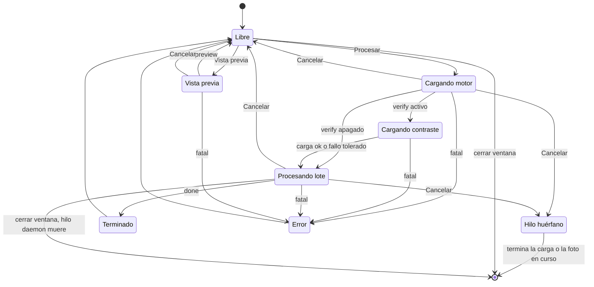
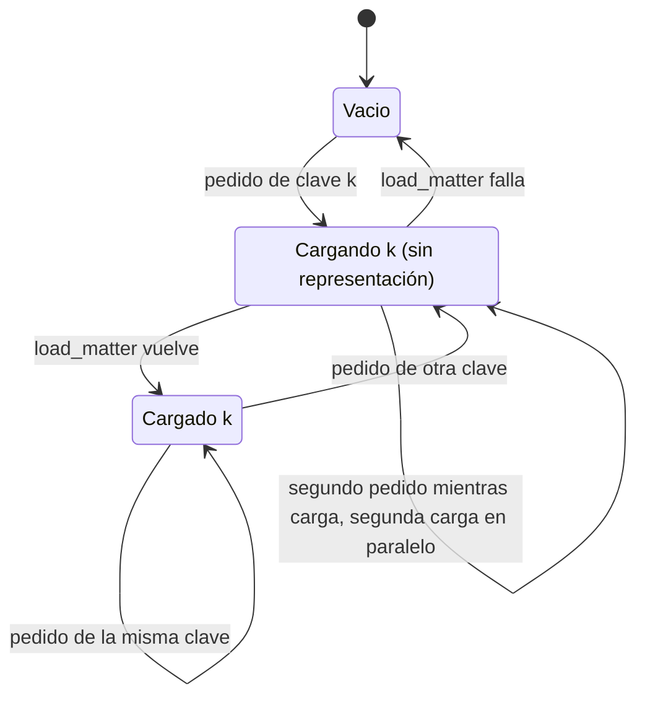
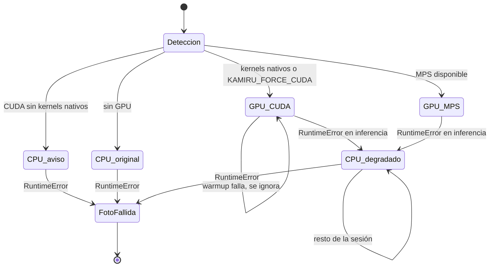
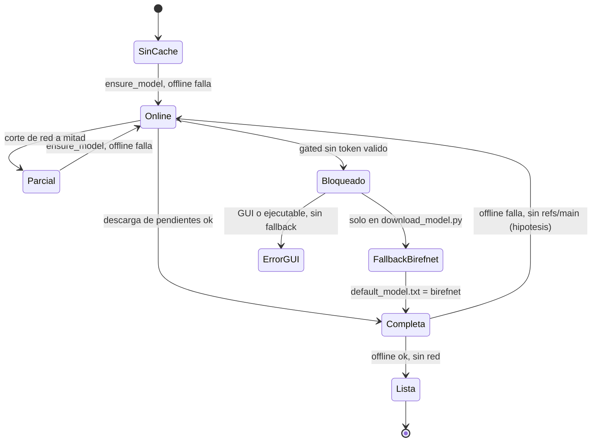
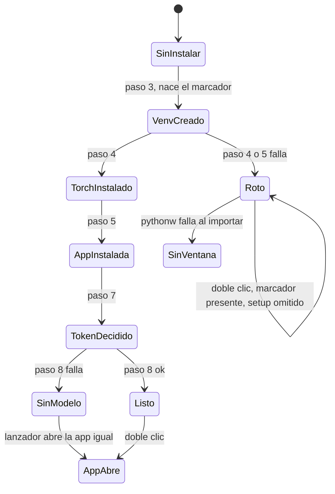
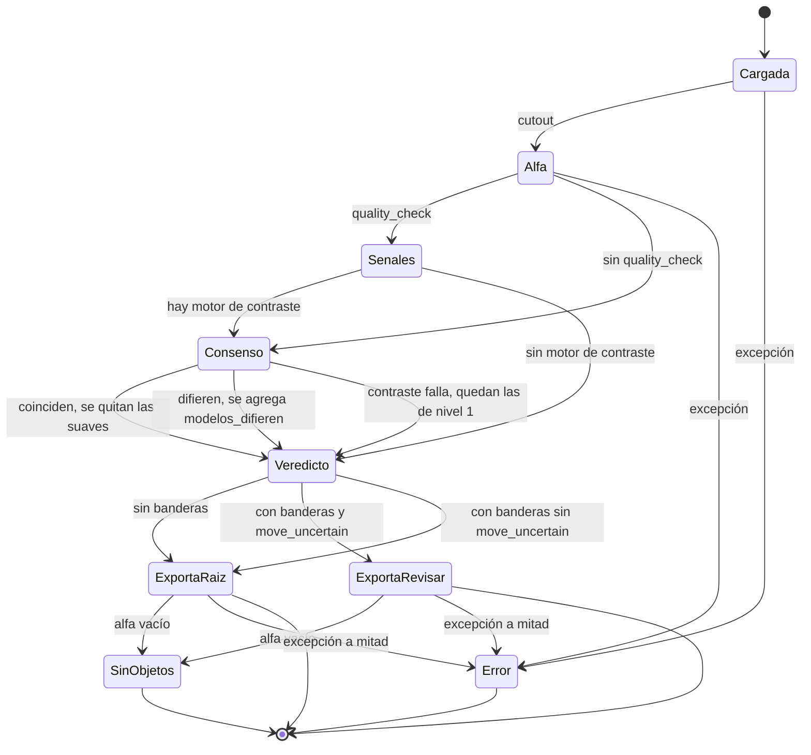
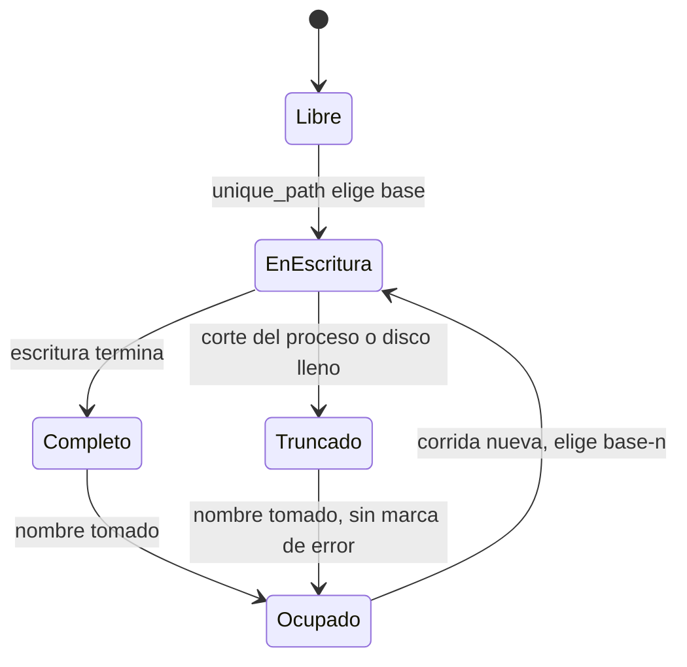
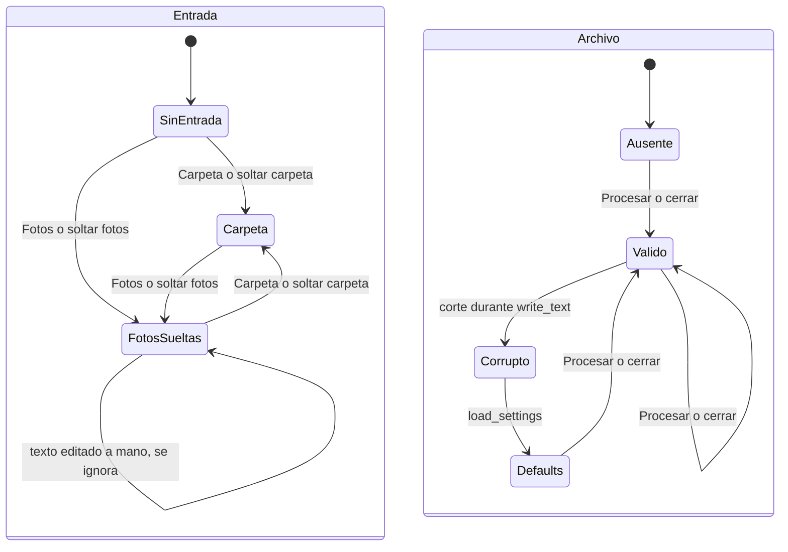
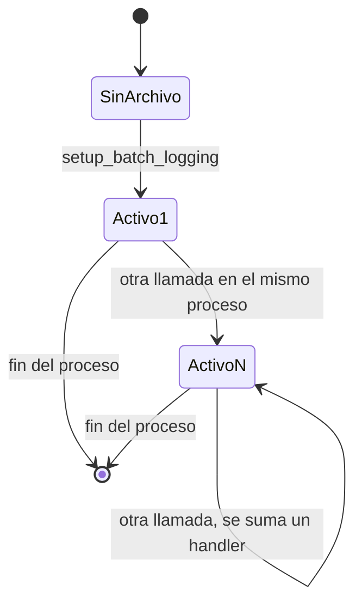
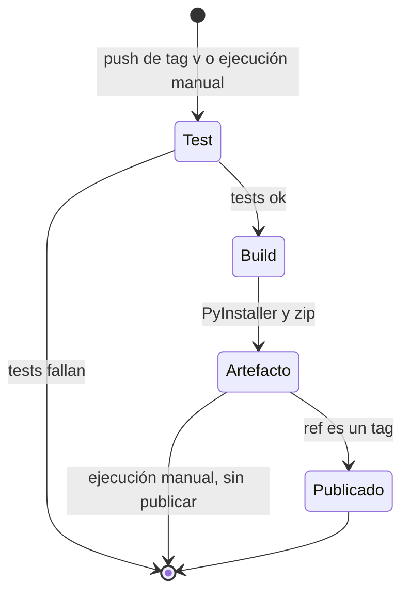

# Máquinas de estado implícitas en Kamiru

## Introducción

**Qué cuenta como máquina de estado implícita.** Es una parte del código donde
una entidad pasa por un conjunto finito de estados a lo largo del tiempo. El
código no tiene un tipo cerrado para esos estados ni una función única de
transición. El estado vive en otra forma: un entero, un `threading.Event`, un
campo que puede valer `None`, la presencia de un archivo, el texto de un widget
o el orden de los pasos de un script.

**Cómo se buscó.** Primero se leyeron `README.md` y `GUIA_KAMILA.md`. Después
se leyó entero cada módulo de `src/kamiru/`, los scripts de `scripts/`, los
lanzadores `Kamiru.bat` y `Kamiru.command`, los dos scripts de instalación,
`packaging/` y los dos workflows de `.github/workflows/`. Con grep se buscaron
escrituras y borrados de archivos (`write_text`, `open(`, `unlink`, `rename`,
`rmtree`), comprobaciones de existencia (`exists`, `is_dir`, `if not exist`),
banderas booleanas, campos opcionales, contadores, `Event`, colas y bucles con
`break`. El repositorio no tiene ningún borrado, renombre ni bloqueo de
archivos.

**Alcance.** Versión 1.2.0, commit `66e9cd3`. Cada referencia `ruta:línea` se
comprobó contra ese código. No se ejecutó la app y no se descargaron modelos.
`huggingface_hub` no estaba instalado en el entorno de revisión. Por eso los
riesgos que dependen del comportamiento interno de esa librería quedan como
hipótesis.

**Marcas de los riesgos.**

- **verificado**: se leyó el camino de código que lo prueba.
- **hipótesis**: depende de una librería externa, de un orden de tiempos o de
  un comportamiento que no se ejecutó.

## Resumen

| # | Máquina | Codificación del estado | Archivo principal | Riesgo principal |
|---|---|---|---|---|
| 1 | Trabajo de la GUI | `_job_gen`, `_cancel`, `_busy_since`, estado de botones, mensajes etiquetados en la cola | `src/kamiru/gui/app.py` | Tras Cancelar, el hilo huérfano sigue exportando y comparte el modelo con el trabajo nuevo. |
| 2 | Caché de motores de la GUI | `_matter`/`_matter_key`, `_verifier`/`_verifier_key` | `src/kamiru/gui/app.py` | El estado "cargando" no existe: Cancelar y Procesar durante la carga cargan el modelo dos veces. |
| 3 | Dispositivo y caída a CPU | `DeviceInfo.kind`, y `_device`/`_half` mutados dentro del motor | `src/kamiru/core/device.py`, `src/kamiru/core/matting.py` | Un solo `RuntimeError` en GPU deja el motor en CPU por el resto de la sesión, sin aviso en la UI. |
| 4 | Provisión y carga del modelo | caché HF en `models/`, `hf_token.txt`, `default_model.txt`, campo `model` de `settings.json` | `src/kamiru/core/model_fetch.py`, `scripts/download_model.py` | Dos fuentes de verdad para el modelo por defecto. El modo offline depende de un archivo de referencia que el código quizá nunca escribe. |
| 5 | Instalación y arranque | existencia de `venv/` y orden de pasos de los scripts | `setup_windows.bat`, `Kamiru.bat` | El marcador de "instalado" aparece antes de que la instalación termine. |
| 6 | Destino de cada foto | `ImageReport.ok/review/outputs/error`, `QualityFlag.soft`, `consensus_iou` | `src/kamiru/core/pipeline.py`, `src/kamiru/core/quality.py` | Una foto sale como confiable sin consenso y el resumen no lo dice. |
| 7 | Carpeta de salida | existencia de archivos con sufijo `-n` | `src/kamiru/core/export.py` | Escritura directa a la ruta final y sin memoria entre corridas: archivos truncados y duplicados. |
| 8 | Configuración y entrada de la GUI | `settings.json`, par `dropped_files` + `input_dir`, par `chroma_auto` + `chroma_color` | `src/kamiru/settings.py`, `src/kamiru/gui/app.py` | La lista de fotos sueltas gana en silencio sobre la ruta escrita a mano. |
| 9 | Log de corrida | lista de handlers del logger `kamiru` | `src/kamiru/core/pipeline.py` | Varias corridas en un mismo proceso duplican líneas entre archivos de log. |
| 10 | Build y release | carpetas `build-env/` y `dist/`, presencia de `nvidia-smi` | `packaging/build_release.bat` | El zip con CUDA y el zip con CPU llevan el mismo nombre. |

---

## 1. Ciclo de vida de un trabajo en la GUI

**Propósito.** Llevar la ventana de "Lista" a "ocupada" y de vuelta, para un
lote o para una vista previa, con cancelación inmediata.

**Dónde.**

- Campos de estado: `src/kamiru/gui/app.py:76-86`.
- `_begin_job`: `src/kamiru/gui/app.py:393-404`. `_end_job`: `src/kamiru/gui/app.py:406-411`. `_is_stale`: `src/kamiru/gui/app.py:413-414`.
- `_start` y su hilo: `src/kamiru/gui/app.py:416-464`.
- `_preview` y su hilo: `src/kamiru/gui/app.py:466-498`.
- `_cancel_run`: `src/kamiru/gui/app.py:529-537`.
- `_poll_queue`, con el filtro por generación: `src/kamiru/gui/app.py:540-595` (filtro en 558-560).
- Bucle del lote y punto de corte: `src/kamiru/core/pipeline.py:259-276` (corte en 260-262).
- Cierre de la ventana: `src/kamiru/gui/app.py:91` y `src/kamiru/gui/app.py:291-293`.

**Cómo se codifica.** No hay un campo de estado. El estado es la combinación de:

- `_job_gen` (entero): identifica el trabajo vigente.
- `_cancel` (`threading.Event`): pedido de corte.
- `_busy_since` (`float` o `None`): `None` significa libre.
- el estado de los botones Procesar, Vista previa y Cancelar.
- el hilo de trabajo. Para el lote se guarda en `_worker` (`app.py:463`), pero
  ningún código lee ese campo. Para la vista previa no se guarda (`app.py:498`).
- los mensajes de la cola. `status`, `progress`, `preview`, `done` y `fatal`
  llevan la generación. `device` y `device_error` no la llevan.
- dentro del hilo, la fase depende del punto del código donde está el hilo:
  carga del motor, carga del motor de contraste o lote.

**Estados.**

- Libre.
- Cargando motor.
- Cargando motor de contraste.
- Procesando lote.
- Vista previa en curso.
- Terminado (libre, con resumen).
- Error (libre, con diálogo).
- Huérfano: hilo viejo vivo mientras la UI ya está libre. Puede coexistir con
  cualquier otro estado.

**Transiciones.**

| Desde | Hacia | Disparador | Código |
|---|---|---|---|
| Libre | Cargando motor | Procesar con entrada y salida válidas | `app.py:416-430`, `_begin_job` en 397-403 |
| Libre | Vista previa | Vista previa con al menos una foto | `app.py:466-479` |
| Cargando motor | Cargando contraste | `spec["verify"]` verdadero | `app.py:438-440` |
| Cargando contraste | Procesando lote | carga correcta, o fallo capturado con aviso | `app.py:441-451` |
| Cargando | Procesando lote | `_is_stale(gen)` falso | `app.py:449-451` |
| Procesando lote | Terminado | mensaje `done` con generación vigente | `app.py:572-582` |
| Vista previa | Libre | mensaje `preview` | `app.py:568-571` |
| Cualquier fase del hilo | Error | excepción en el hilo, mensaje `fatal` | `app.py:459-461`, `494-496`, `583-591` |
| Cualquier fase ocupada | Libre + Huérfano | Cancelar: pone `_cancel`, incrementa `_job_gen`, libera botones | `app.py:532-534` |
| Huérfano en carga | fin del hilo | la carga termina, el motor queda en caché | `app.py:352`, `450`, `486` |
| Huérfano en lote | fin del hilo | termina la foto en curso y corta en la vuelta siguiente | `pipeline.py:260-262` |
| Cualquiera | proceso terminado | cerrar la ventana; los hilos son `daemon` | `app.py:291-293`, `463`, `498` |

**Invariantes.**

- **I1.1. La UI solo reacciona a mensajes del trabajo vigente.** Se cumple. El
  filtro está en `app.py:558-560`. `_is_stale` compara la generación además del
  `Event` (`app.py:414`). Por eso el `self._cancel.clear()` de un trabajo nuevo
  (`app.py:399`) no revive al huérfano. Este mecanismo es sólido.
- **I1.2. Las variables Tk se leen solo en el hilo principal.** Se cumple.
  `_matter_spec` (`app.py:322-331`) y `_validated_options`
  (`app.py:378-391`) corren antes de lanzar el hilo. El hilo recibe valores
  planos.
- **I1.3. Un solo trabajo usa el motor a la vez.** No se cumple. Ningún código
  espera al huérfano antes de lanzar otro trabajo.
- **I1.4. Todo trabajo deja la UI libre al terminar.** Se cumple para `done`,
  `fatal`, `preview` y Cancelar. Si el hilo muere por una excepción que no
  hereda de `Exception`, la UI queda ocupada hasta Cancelar. Es una hipótesis de
  bajo impacto, y Cancelar la resuelve.

**Riesgos.**

- **R1.1 (verificado). El hilo huérfano corre en paralelo con el trabajo
  nuevo.** Tras Cancelar durante un lote, el huérfano termina la foto en curso
  y la exporta. La comprobación de corte está solo al inicio de cada vuelta
  (`pipeline.py:260`), y `process_image` corre entero (`pipeline.py:266`). Si
  la persona aprieta Procesar enseguida, dos hilos llaman `cutout` sobre el
  mismo objeto `self._matter` (`app.py:342-343`). En GPU eso duplica la
  memoria de activaciones. Si uno de los dos hilos dispara la caída a CPU
  (máquina 3), el otro hilo puede tener tensores en el dispositivo viejo
  (hipótesis).
- **R1.2 (verificado). El resumen de un lote cancelado se pierde.**
  `run_batch` devuelve un `BatchSummary` también cuando corta
  (`pipeline.py:262`, `278`). El mensaje `done` del huérfano llega con una
  generación vieja y la UI lo descarta (`app.py:559-560`). Los archivos ya
  exportados quedan en disco y solo el log los registra.
- **R1.3 (verificado). Cerrar la ventana durante un lote no pide
  confirmación.** `_on_close` guarda la configuración y destruye la ventana
  (`app.py:291-293`). El hilo `daemon` muere cuando sale el intérprete. Si el
  hilo estaba escribiendo un archivo, el archivo queda truncado con su nombre
  final, porque las escrituras van directo a la ruta final (máquina 7).
- **R1.4 (hipótesis, de tiempos). El huérfano y el trabajo nuevo pueden elegir
  el mismo nombre.** Los dos llaman `unique_path` (`export.py:30-37`) sobre la
  misma carpeta. Comprobar y escribir son dos pasos separados. Si los dos hilos
  eligen el mismo nombre antes de que uno escriba, el segundo pisa al primero.
  Eso rompe la regla "nunca se sobrescribe".
- **R1.5 (verificado, bajo impacto). El mensaje `device` no lleva
  generación.** `import torch` tarda varios segundos (`app.py:220-229`). Si el
  mensaje llega después de empezar un trabajo, el aviso de dispositivo pisa la
  línea de estado y el cuadro de resumen (`app.py:545-551`).
- **R1.6 (verificado, bajo impacto). "Abrir salida" queda habilitado para
  siempre** tras el primer `done` (`app.py:575`). `_open_output` comprueba la
  carpeta antes de abrirla (`app.py:279`), así que no falla.

---

## 2. Caché de motores en la GUI

**Propósito.** Reusar el modelo cargado entre Procesar y Vista previa, y
aprovechar una carga que siguió de fondo tras Cancelar.

**Dónde.**

- Campos: `src/kamiru/gui/app.py:79-82`.
- Motor principal: `_build_matter`, `src/kamiru/gui/app.py:333-353` (acierto en 342-343, escritura en 352).
- Motor de contraste: `_build_verifier`, `src/kamiru/gui/app.py:355-376` (acierto en 367-368, escritura en 375).
- Croma, fuera de la caché: `src/kamiru/gui/app.py:336-340`.

**Cómo se codifica.** Dos pares de campos opcionales, uno por rol:
`(_matter, _matter_key)` y `(_verifier, _verifier_key)`. La clave es
`(modelo, resolución)`. El motor croma no pasa por la caché: cada trabajo crea
un `ChromaMatter` nuevo.

**Estados por rol.**

- Vacío: el objeto vale `None`.
- Cargado(clave).
- Cargando(clave). El código no representa este estado. Existe solo como un
  hilo que está dentro de `load_matter`.

**Transiciones.**

- Vacío → Cargando(k): pedido de cualquier clave (`app.py:346`, `371`).
- Cargando(k) → Cargado(k): `load_matter` vuelve. La asignación ocurre aunque
  el trabajo esté cancelado (`app.py:350-352`, `375`).
- Cargando(k) → estado anterior: `load_matter` lanza una excepción.
- Cargado(k) → Cargado(k): acierto (`app.py:342-343`, `367-368`).
- Cargado(k) → Cargando(k2): pedido de otra clave. El motor viejo pierde su
  referencia cuando la carga nueva termina.

**Invariantes.**

- **I2.1. El objeto en caché corresponde a su clave.** Se cumple. Objeto y
  clave se asignan en una sola tupla (`app.py:352`, `375`).
- **I2.2. La clave describe todo lo que cambia el resultado.** No se cumple. La
  clave no incluye el dispositivo. Tras una caída a CPU (máquina 3) el objeto
  conserva la clave, y la caché sirve un motor degradado.
- **I2.3. Hay una sola carga por clave.** No se cumple (R2.1).

**Riesgos.**

- **R2.1 (verificado). Doble carga.** La persona cancela durante la carga y
  aprieta Procesar antes de que la carga termine. El hilo nuevo ve `_matter` en
  `None` (`app.py:342`) y llama `load_matter` otra vez (`app.py:346`). Corren
  dos cargas en paralelo: dos copias de los pesos en RAM y en VRAM, y dos
  descargas si el modelo no estaba en disco. El README dice que "la carga sigue
  de fondo y se aprovecha en el próximo Procesar". Eso vale solo si la carga ya
  terminó.
- **R2.2 (verificado). Gana la última escritura.** Si el huérfano carga la
  clave A y el trabajo nuevo carga la clave B, la caché guarda la que termina
  última. El Procesar siguiente con B puede recargar sin necesidad.
- **R2.3 (verificado). No hay caché de fallos para el contraste.** Si el motor
  de contraste no carga, `_verifier` queda en `None` y cada Procesar reintenta
  la carga. Con una red que no responde, cada intento puede esperar hasta
  `NETWORK_TIMEOUT` = 30 s (`model_fetch.py:22`, `59`).
- **R2.4 (verificado, bajo impacto). Los dos motores quedan en memoria hasta
  cerrar la app.** Es una decisión válida para el reuso. Con resolución 2048 la
  VRAM puede agotarse, y eso lleva a R3.1.

---

## 3. Dispositivo de cómputo y caída de GPU a CPU

**Propósito.** Elegir CUDA, MPS o CPU al cargar el motor, y pasar a CPU si una
inferencia falla en GPU.

**Dónde.**

- `arch_status`: `src/kamiru/core/device.py:23-46`.
- `detect_device`: `src/kamiru/core/device.py:55-79` (`KAMIRU_FORCE_CUDA` en 62).
- Detección al crear el motor: `src/kamiru/core/matting.py:119`.
- Tipo numérico y movimiento a dispositivo: `src/kamiru/core/matting.py:153-163`.
- Warmup: `src/kamiru/core/matting.py:165-178`.
- Inferencia con caída: `src/kamiru/core/matting.py:194-209` (mutación en 204-206).
- Etiqueta de dispositivo en la GUI: `src/kamiru/gui/app.py:220-229` y `545-551`.

**Cómo se codifica.** La elección inicial es un `DeviceInfo` con `kind` en
`"cuda" | "mps" | "cpu"` y un `warning` opcional. Después, el estado real del
motor son tres valores mutables: `self._device`, `self._half` y el dispositivo
de los pesos de `self.model`. `self.device_info.kind` no cambia nunca, ni
siquiera tras la caída.

**Estados.**

- Detección: CUDA nativa; CUDA forzada; CUDA sin kernels nativos (pasa a CPU
  con aviso); MPS; CPU sin GPU.
- Ejecución: GPU (fp16 en CUDA, fp32 en MPS); CPU original; CPU degradado
  (llegó por caída).

**Transiciones.**

- `arch_status` da `"native"`, o `KAMIRU_FORCE_CUDA` tiene texto → CUDA
  (`device.py:62-63`).
- CUDA disponible sin kernels nativos (`"jit"` o `"unsupported"`) → CPU con
  aviso (`device.py:64-76`).
- MPS disponible → MPS (`device.py:77-78`). Ninguna GPU → CPU (`device.py:79`).
- El warmup falla → se registra y el motor sigue en GPU (`matting.py:177-178`).
- GPU y `RuntimeError` en `_forward` → mueve los pesos a CPU, fija `_device` y
  `_half`, y reintenta una vez (`matting.py:200-207`). Este paso es de una sola
  vía.
- CPU y `RuntimeError` → la foto falla (`matting.py:209`).

**Invariantes.**

- **I3.1. `_half` es verdadero solo con pesos en CUDA.** Se cumple
  (`matting.py:154-156`, `206`).
- **I3.2. Tensor de entrada y pesos están en el mismo dispositivo.** Se cumple
  con un solo hilo, porque `_preprocess` lee `self._device` en cada llamada
  (`matting.py:189`). No se cumple con dos hilos sobre el mismo motor (R1.1).
- **I3.3. La UI muestra el dispositivo real.** No se cumple. La etiqueta se fija
  una sola vez al inicio (`app.py:547`) y viene de una detección aparte
  (`app.py:225`).

**Riesgos.**

- **R3.1 (verificado en el código; el tipo de excepción viene de PyTorch).
  Caída permanente y silenciosa.** Cualquier `RuntimeError` en GPU lleva el
  motor a CPU. Eso incluye `torch.cuda.OutOfMemoryError`, que hereda de
  `RuntimeError`: por ejemplo una foto a 2048 con dos motores en VRAM. No hay
  vuelta a GPU. La caché de la GUI (máquina 2) sigue sirviendo ese motor hasta
  que cambie el modelo o la resolución, o hasta cerrar la app. El único rastro
  es un `log.warning` (`matting.py:203`). El lote sigue mucho más lento y la
  etiqueta sigue diciendo "GPU NVIDIA".
- **R3.2 (verificado). El comentario y el código dicen cosas distintas.** El
  comentario de `matting.py:202` habla de ops no soportadas en MPS. El código
  aplica la caída a cualquier dispositivo distinto de CPU, CUDA incluida
  (`matting.py:201`).
- **R3.3 (verificado). `KAMIRU_FORCE_CUDA=0` también fuerza la GPU.** La
  condición solo mira que la variable tenga texto (`device.py:62`).
- **R3.4 (verificado, bajo impacto). Un warmup fallido no cambia el estado**
  (`matting.py:177-178`). La primera foto real probablemente repite el error y
  dispara R3.1. Esa última parte es una hipótesis sobre la causa del fallo.
- **Parte sólida.** `arch_status` es una función pura con tests
  (`tests/test_device_and_fetch.py:7-29`) y evita el cuelgue por compilación
  JIT de kernels.

---

## 4. Provisión y carga del modelo

**Propósito.** Tener los pesos en disco, con token o sin él, y decidir qué
modelo usa la app por defecto. La máquina cruza cuatro procesos distintos: el
script de setup, `scripts/download_model.py`, la GUI y la CLI.

**Dónde.**

- Token en el setup: `setup_windows.bat:69-79`, `setup_macos.command:54-64`.
- Descarga en el setup: `setup_windows.bat:84-88`, `setup_macos.command:69`.
- `scripts/download_model.py:33-64` (escritura de `default_model.txt` en 45 y 57).
- `ensure_model`: `src/kamiru/core/model_fetch.py:33-89` (offline en 48-53, online en 55-89).
- Rutas, token y archivo de modelo por defecto: `src/kamiru/paths.py:39-47`, `50-63`, `66-68`.
- `resolve_default_model`: `src/kamiru/core/matting.py:55-62`.
- Fases de carga: `src/kamiru/core/matting.py:130-179`.
- Elección del modelo: GUI en `src/kamiru/gui/app.py:65` y `302`; CLI en `src/kamiru/cli.py:48`.

**Cómo se codifica.** Con archivos y variables de entorno, sin un registro
central:

- la caché de HuggingFace bajo `models/` (`HF_HOME`, `paths.py:42`): vacía,
  parcial o completa.
- `models/hf_token.txt` o la variable `HF_TOKEN`: ausente, válido o inválido.
- `models/default_model.txt`: ausente, `rmbg-2.0` o `birefnet`.
- el campo `model` de `settings.json` (`settings.py:25`). La GUI lo escribe en
  cada Procesar y al cerrar (`app.py:428`, `292`, `302`).
- las fases de carga de `NeuralMatter.__init__`, visibles solo como mensajes
  de progreso: resolver caché (`matting.py:134`), leer pesos (138-142), tipo
  numérico (154-159), mover a GPU (163), warmup (168-178), listo (179).

**Estados.**

- Por repositorio: SinCaché, Parcial, Completa.
- Por instalación: Listo con `rmbg-2.0`, Listo con `birefnet`, Bloqueado
  (repositorio gated sin acceso).

**Transiciones.**

- `ensure_model` intenta primero `snapshot_download(repo, local_files_only=True)`
  (`model_fetch.py:49`). Si vuelve, la ruta sale sin red. Si falla, pasa al
  camino online: `model_info` con timeout (59), descarga de los archivos
  pendientes con `revision=info.sha` (79-84) y ruta del primer archivo (87-89).
- `download_model.py`: éxito → escribe la clave en `default_model.txt` (45).
  `GatedRepoError` o `HfHubHTTPError` → descarga `birefnet` y escribe
  `birefnet` (49-58). Otro error (red caída, timeout) → sale con traza.
- GUI: modelo = `settings.model` si no está vacío, si no `resolve_default_model()`
  (`app.py:65`). CLI: siempre `resolve_default_model()` (`cli.py:48`).
- Carga con un error que contiene "gated" o "401" → `RuntimeError` con la ayuda
  `GATED_HELP` (`matting.py:143-148`). Otro error → se relanza (149).

**Invariantes.**

- **I4.1. Con el modelo en caché, la carga no toca la red** (README, sección
  "Solución de problemas"). Depende de que `snapshot_download` en modo local
  encuentre el snapshot. Ver R4.1.
- **I4.2. `HF_HOME` se fija antes de importar `huggingface_hub`.** Se cumple
  por el orden de las llamadas: `matting.py:111` va antes de 113-114, y
  `download_model.py:38` va antes de 41. Ninguna guardia lo asegura. Un import
  futuro de `huggingface_hub` a nivel de módulo lo rompería.
- **I4.3. `default_model.txt` dice qué modelo usa la app.** Se cumple para la
  CLI. No se cumple para la GUI (R4.3).

**Riesgos.**

- **R4.1 (hipótesis, depende de `huggingface_hub`). El camino offline puede no
  activarse nunca en una instalación nueva.** `ensure_model` descarga siempre
  con `revision=info.sha` (`model_fetch.py:82`, `87`). Según la implementación
  conocida de `huggingface_hub`, con una revisión que ya es un hash de commit la
  librería no escribe `refs/main`. A su vez, `snapshot_download` en modo local
  y sin revisión necesita `refs/main` para encontrar el snapshot. Si las dos
  cosas son ciertas, cada carga pasa por `model_info` (`model_fetch.py:59`), y
  sin internet la app falla aunque los pesos estén en disco. Cómo comprobarlo:
  en una instalación nueva, mirar si existe
  `models/hub/models--briaai--RMBG-2.0/refs/main`. El commit `987b84e` dice que
  la carga offline se probó. Esa caché pudo venir de una versión anterior que
  sí escribía la referencia.
- **R4.2 (hipótesis, depende de `huggingface_hub`). Caché parcial sin
  salida.** Si `refs/main` existe y faltan archivos del snapshot (descarga
  cortada), `snapshot_download` en modo local devuelve la carpeta sin comprobar
  que esté completa. `from_pretrained` falla y el mensaje no contiene "gated"
  ni "401". Cada Procesar repite el mismo camino. Desde la app no hay forma de
  salir de ese estado. El test `test_incomplete_cache_falls_to_online`
  (`tests/test_device_and_fetch.py:56`) simula este caso con un falso que
  lanza una excepción, así que no prueba el comportamiento real de la librería.
- **R4.3 (verificado). Dos fuentes de verdad para el modelo por defecto.** La
  GUI usa `settings.model` si tiene texto (`app.py:65`) y lo guarda en cada
  Procesar y al cerrar (`app.py:292`, `302`, `428`). Tras el primer cierre,
  `default_model.txt` ya no influye en la GUI. Caso concreto: el setup sin
  token deja `birefnet`. Más tarde se pega el token y se corre
  `download_model.py`, que escribe `rmbg-2.0`. La GUI sigue con `birefnet`. El
  README promete este cambio de vuelta a RMBG-2.0. La promesa vale solo para la
  CLI.
- **R4.4 (verificado). El ejecutable empaquetado no tiene caída a
  `birefnet`.** El ejecutable no pasa por el setup. Sin `default_model.txt` el
  modelo es `rmbg-2.0` (`matting.py:58-62`). Sin token, el primer Procesar
  termina en `fatal` con la ayuda `GATED_HELP`. La caída automática a
  `birefnet` existe solo en `download_model.py` (52-58). El README dice que al
  primer uso la app descarga el modelo. Eso vale solo con un token válido.
- **R4.5 (verificado). Un token inválido queda fijo.** El setup pide el token
  solo si `hf_token.txt` no existe (`setup_windows.bat:70`,
  `setup_macos.command:55`). Con un token mal pegado, cada corrida nueva del
  setup cae a `birefnet` sin volver a preguntar. Para corregirlo hay que editar
  o borrar el archivo a mano.
- **R4.6 (verificado). `download_model.py` captura solo errores HTTP de
  HuggingFace** (`download_model.py:49`). Un corte de red o un timeout sale
  como traza y no pasa a `birefnet`.
- **R4.7 (verificado, bajo impacto). `HF_HOME` usa `setdefault`**
  (`paths.py:42`). Si el sistema ya define `HF_HOME`, los pesos van a la caché
  global. `models/` queda solo con el token y el modelo por defecto.

---

## 5. Instalación y arranque

**Propósito.** Llevar una carpeta recién copiada a una app que abre con doble
clic. La máquina cruza tres procesos: lanzador, script de setup e intérprete de
la app.

**Dónde.**

- Lanzador Windows: `Kamiru.bat:4-9`. Lanzador macOS: `Kamiru.command:4-9`.
- Setup Windows: `setup_windows.bat:14-93`. Setup macOS: `setup_macos.command:7-73`.
- Dependencias de la app: `pyproject.toml:12-25`.
- Guardas de la GUI sin consola: `src/kamiru/runtime.py:17-25`.

**Cómo se codifica.** La presencia de un archivo marca la fase. El lanzador
mira solo `venv\Scripts\pythonw.exe` (`Kamiru.bat:4`) o `venv/bin/python`
(`Kamiru.command:4`). Los pasos del setup forman una secuencia sin registro de
avance.

**Estados.** SinInstalar; VenvCreado (el marcador ya existe); TorchInstalado;
AppInstalada; TokenDecidido; ModeloListo; Listo. Cada paso tiene su error.

**Transiciones (Windows).**

| Paso | Disparador | Código | Control de error |
|---|---|---|---|
| lanzador sin marcador | doble clic | `Kamiru.bat:4-6` (`call setup_windows.bat`) | sí, vuelve a mirar el marcador en 7 |
| 1. Python 3.10-3.12 | inicio del setup | `setup_windows.bat:14-31` | sí |
| 3. venv | `if not exist venv` | `setup_windows.bat:44-46` | sí; aquí nace el marcador |
| 4. torch CUDA | `nvidia-smi` presente | `setup_windows.bat:50-56` | sí |
| 4. torch CPU | `nvidia-smi` ausente | `setup_windows.bat:59` | no |
| 5. app | siempre | `setup_windows.bat:63` | sí |
| 7. token | `hf_token.txt` ausente | `setup_windows.bat:69-79` | no aplica |
| 8. modelo | siempre | `setup_windows.bat:84-88` | sí |
| lanzador tras setup | marcador presente | `Kamiru.bat:7-9` | abre la app aunque el setup haya fallado |

En macOS la secuencia es la misma. `set -e` (`setup_macos.command:7`) corta el
script en el primer error, sin el "Enter para cerrar".

**Invariantes.**

- **I5.1. Marcador presente implica instalación completa.** No se cumple. El
  marcador nace en el paso 3, antes de torch, de la app y del modelo.

**Riesgos.**

- **R5.1 (verificado). La app no abre y no dice nada.** Si el paso 5 falla en
  Windows (`setup_windows.bat:63`), el venv ya existe. El lanzador vuelve a la
  línea 7, ve `pythonw.exe` y ejecuta `pythonw -m kamiru.gui.app`
  (`Kamiru.bat:9`). Sin el paquete `kamiru`, `pythonw` falla al importar y no
  tiene consola, así que no aparece ninguna ventana ni mensaje.
  `ensure_std_streams` (`runtime.py:17-25`) no corre, porque está dentro del
  paquete que falta. Los doble clic siguientes repiten lo mismo y no vuelven a
  llamar al setup. La guía solo dice "¿La ventana no abre? Avísale a Sebastian".
- **R5.2 (verificado). Torch para CPU se instala sin control de error**
  (`setup_windows.bat:59`). Si falla, el setup sigue. `pyproject.toml` no lista
  `torch` (12-25), así que el paso 5 no lo trae. La GUI abre y muestra "PyTorch
  no disponible" (`app.py:552-554`). Procesar termina en `fatal`.
- **R5.3 (verificado). Un fallo en la descarga del modelo no impide abrir la
  app.** El setup sale con 1 en el paso 8, pero el lanzador abre la app igual
  (`Kamiru.bat:7-9`, `Kamiru.command:7-9`). Esto sirve como recuperación,
  porque la GUI descarga en el primer Procesar. Pero queda sin
  `default_model.txt`, con las limitaciones de R4.4.
- **R5.4 (hipótesis, bajo impacto).** Un `venv/` creado antes con otro Python
  se reutiliza sin comprobar la versión (`setup_windows.bat:44`,
  `setup_macos.command:41`). Con Python 3.13 la instalación de dependencias
  fallaría, según el README.

---

## 6. Destino de cada foto en el lote (control de calidad y `revisar/`)

**Propósito.** Decidir por cada foto si se exporta, en qué carpeta, y si hay que
mirarla a mano.

**Dónde.**

- `process_image`: `src/kamiru/core/pipeline.py:143-230`.
- Señales de nivel 1 y consenso: `src/kamiru/core/pipeline.py:158-172`.
- Desvío a `revisar/`: `src/kamiru/core/pipeline.py:173-179`.
- Exportación por modo: `src/kamiru/core/pipeline.py:181-227`.
- Aislamiento de errores: `src/kamiru/core/pipeline.py:265-274`.
- Grupos y texto del resumen: `src/kamiru/core/pipeline.py:83-128`.
- `QualityFlag.soft`: `src/kamiru/core/quality.py:46-50`. `assess_cutout`: `src/kamiru/core/quality.py:63-130`. `merge_flags`: `src/kamiru/core/quality.py:156-172`.
- Vista previa: `src/kamiru/gui/app.py:490-493`.

**Cómo se codifica.** `ImageReport` (`pipeline.py:65-76`) combina `ok`
(booleano), `error` (texto o `None`), `outputs` (lista), `review` (booleano),
`review_reasons` y `consensus_iou` (`float` o `None`). Cada bandera es un
`QualityFlag` con `soft`. La carpeta destino se deduce: `out_dir` o
`out_dir/revisar`. Los grupos del resumen (`failed`, `empty`, `to_review`) son
propiedades derivadas de esos campos.

**Estados.** Pendiente → Cargada → Alfa calculado → Señales de nivel 1 →
Consenso (coinciden, difieren o sin consenso) → Veredicto (confiable o dudosa)
→ Exportación. Estados terminales: Exportada confiable; Exportada dudosa (en
`revisar/` o en la raíz); Sin objetos; Error.

**Transiciones.**

- Excepción en carga, alfa o exportación → Error (`pipeline.py:271-273`).
- `quality_check` falso → no hay señales de nivel 1 (`pipeline.py:159`).
- Con motor de contraste:
  - IoU de 0.90 o más → se quitan las banderas `soft` (`quality.py:166-167`).
  - IoU menor que 0.90 → se agrega `modelos_difieren`, que es dura
    (`quality.py:168-172`).
  - el contraste lanza una excepción → quedan las señales de nivel 1 y
    `consensus_iou` sigue en `None` (`pipeline.py:167-170`).
- Banderas no vacías → dudosa (`pipeline.py:171`). Con `move_uncertain` → el
  destino pasa a `revisar/` (`pipeline.py:176-179`).
- Conjunto sin contenido, o individual sin componentes → Sin objetos
  (`pipeline.py:183-184`, `206-207`).

**Invariantes.**

- **I6.1. Lo que queda fuera de `revisar/` es confiable** (README y guía). Se
  cumple dentro de una corrida con `move_uncertain` activo
  (`pipeline.py:176-179`). No se cumple entre corridas (R6.3). Tampoco se
  cumple en la CLI sin `--revisar`, que es el valor por defecto
  (`cli.py:56-57`).
- **I6.2. `ok=False` implica `outputs=[]`.** Se cumple en el objeto, porque el
  informe de error se crea nuevo (`pipeline.py:273`). En disco no se cumple
  (R6.2).
- **I6.3. Con el contraste activo, una foto confiable pasó por los dos
  niveles.** No se cumple (R6.1).

**Riesgos.**

- **R6.1 (verificado). El contraste falta y nada lo dice.** Si el motor de
  contraste falla en una foto, la excepción va al log y la foto sigue solo con
  las señales de nivel 1 (`pipeline.py:167-170`). El texto del resumen no usa
  `consensus_iou` (`pipeline.py:107-128`), así que no dice qué fotos quedaron
  sin consenso. Si el motor de contraste no carga para todo el lote, la GUI
  envía un `status` (`app.py:446-448`). El primer mensaje `progress` lo tapa
  enseguida (`app.py:565`). La persona cree que hubo dos modelos.
- **R6.2 (verificado). Exportación individual cortada a mitad.** Si la pieza k
  falla (disco lleno, permisos), las piezas 1 a k-1 ya están en disco
  (`pipeline.py:221-227`). La excepción sale de `process_image` y `run_batch`
  crea un informe nuevo sin esas rutas (`pipeline.py:273`). El resumen cuenta
  la foto como error y `files_exported` no cuenta esos archivos. Quedan
  archivos sin dueño, y quizá uno truncado.
- **R6.3 (verificado). No hay memoria entre corridas.** Ningún código borra ni
  mueve salidas anteriores: el repositorio no tiene `unlink`, `rename` ni
  `rmtree`. Una foto confiable en la corrida 1 y dudosa en la corrida 2 (otro
  modelo, otra resolución) queda en la raíz y en `revisar/`. La copia de la raíz
  parece confiable.
- **R6.4 (verificado, bajo impacto). La vista previa usa solo el nivel 1**
  (`app.py:492`). Una bandera suave que el consenso del lote quitaría aparece
  como "Recorte dudoso" en la vista previa. Para la misma foto, la vista previa
  y el lote pueden dar veredictos distintos.
- **R6.5 (verificado, bajo impacto).** El resumen deduce "movido a revisar" por
  el nombre de la carpeta padre (`pipeline.py:113-115`). Si la carpeta de
  salida elegida ya se llama `revisar`, el resumen dice que movió las dudosas
  aunque `move_uncertain` esté apagado.
- **Parte sólida.** El aislamiento de errores por foto funciona bien
  (`pipeline.py:265-274`). La combinación de banderas es determinista y tiene
  tests (`tests/test_quality.py:98-107` y siguientes).

---

## 7. Carpeta de salida como registro de estado

**Propósito.** Dar a cada archivo un nombre que no pise otro.

**Dónde.**

- `unique_path`: `src/kamiru/core/export.py:30-37`.
- `numbered_stem`: `src/kamiru/core/export.py:40-42`.
- Escrituras: PNG en `src/kamiru/core/export.py:45-48`, TIFF en `51-73`, PSD en `src/kamiru/core/psd_writer.py:187-188`.
- `export_single`: `src/kamiru/core/export.py:87-108` (nombre en 98).
- Llamadas desde el lote: `src/kamiru/core/pipeline.py:187-188`, `205`, `215-218`, `223-226`.

**Cómo se codifica.** Por la existencia de archivos en la carpeta. Para cada
nombre base, el estado es el conjunto de archivos `base`, `base-1`, `base-2`...
que existen. `unique_path` lee ese estado y elige el primer hueco. Un archivo
en escritura y un archivo truncado no tienen ninguna marca: por el nombre son
iguales a un archivo completo.

**Estados por nombre base.** Libre; Ocupado(n); En escritura; Completo;
Truncado.

**Transiciones.**

- Exportar → `unique_path` elige el nombre → escritura directa a la ruta final.
- Corte durante la escritura (cierre de ventana, disco lleno, apagón) → Truncado.
- Corrida nueva sobre la misma carpeta → siempre un n nuevo.

**Invariantes.**

- **I7.1. Nunca se sobrescribe.** Se cumple con un solo escritor. No se cumple
  con dos escritores a la vez (R1.4).
- **I7.2. El nombre de salida identifica la foto de origen.** No se cumple. Dos
  fuentes con la misma base (`foto.jpg` y `foto.png`) o una corrida repetida
  dan `foto.png` y `foto-1.png`. El nombre ya no dice de qué foto ni de qué
  corrida viene.

**Riesgos.**

- **R7.1 (verificado). Escritura no atómica.** PNG, TIFF y PSD van directo a la
  ruta final (`export.py:48`, `66-73`; `psd_writer.py:187-188`). No hay
  archivo temporal ni renombre. Un corte deja un archivo truncado con un nombre
  válido. La corrida siguiente lo ve como ocupado y escribe `-1` al lado.
- **R7.2 (verificado). No hay reanudación.** Si la persona cancela en la foto 40
  de 100 y vuelve a procesar, el lote rehace las 100. Las 40 primeras salen otra
  vez con `-1`. No existe un manifiesto ni una marca de "hecho".
- **R7.3 (hipótesis, de tiempos).** Ver R1.4.

---

## 8. Configuración de la GUI y origen de la entrada

**Propósito.** Recordar la configuración entre sesiones y saber qué fotos
procesar.

**Dónde.**

- `Settings`, carga y guardado: `src/kamiru/settings.py:18-33`, `40-50`, `53-59`.
- Lectura en la GUI: `src/kamiru/gui/app.py:57-74`.
- Guardado desde la GUI: `src/kamiru/gui/app.py:295-308`.
- Origen de la entrada: `src/kamiru/gui/app.py:232-262` y `311-320`.
- Croma: `src/kamiru/gui/app.py:72-73`, `269-275`, `336-340`.

**Cómo se codifica.**

- `settings.json`: ausente, válido o corrupto. Sus valores no se validan por
  tipo.
- Origen de la entrada: el par (`dropped_files`, texto de `input_dir`). Lista no
  vacía significa "fotos sueltas". Lista vacía significa "la ruta del texto".
- Croma: el par (`chroma_auto`, `chroma_color`).

**Transiciones del origen de la entrada.**

- Soltar una carpeta → modo carpeta, se vacía la lista (`app.py:236-239`).
- Soltar fotos, o el botón Fotos… → modo fotos sueltas, el campo muestra
  "N foto(s) elegidas" (`app.py:240-247`, `261-262`).
- Botón Carpeta… → modo carpeta, se vacía la lista (`app.py:251-253`).
- Escribir en el campo a mano → ninguna transición.

**Transiciones de `settings.json`.**

- Ausente → valores por defecto (`settings.py:42-43`).
- Corrupto → valores por defecto y un aviso en el log (`settings.py:48-50`).
- Cualquier estado → válido al apretar Procesar o al cerrar (`app.py:428`,
  `292`).

**Invariantes.**

- **I8.1. La entrada procesada es la que muestra la pantalla.** No se cumple
  (R8.1).
- **I8.2. Los valores cargados son válidos.** Se cumple para `format_label` y
  `resolution` (`app.py:61-67`) y para `min_area`, que se valida al apretar
  Procesar (`app.py:379-383`). No se cumple para `mode` ni para `model` (R8.2).

**Riesgos.**

- **R8.1 (verificado). La lista de fotos gana en silencio.** El campo de entrada
  es editable (`app.py:115`). Tras elegir fotos sueltas, el campo dice "N
  foto(s) elegidas" (`app.py:245`). Si la persona escribe después una ruta de
  carpeta en ese campo, `dropped_files` sigue lleno y `_collect_inputs`
  devuelve la lista vieja (`app.py:312-313`). La app procesa otra cosa que la
  que muestra la pantalla.
- **R8.2 (verificado). Valores no validados al cargar.** `load_settings` filtra
  por nombre de campo y no por valor (`settings.py:46-47`). Un `mode`
  desconocido deja los dos botones de radio sin marcar. Termina en `fatal` dentro
  del hilo, por `BatchOptions.validate` (`pipeline.py:57-58`). Un `model`
  desconocido termina en `fatal` al crear el motor (`matting.py:109-110`).
- **R8.3 (verificado, impacto aceptable). `settings.json` se escribe sin paso
  atómico** (`settings.py:55-57`). Un corte a mitad deja JSON roto. La carga
  siguiente vuelve a los valores por defecto (`settings.py:48-50`) y el cierre
  siguiente reescribe el archivo. Se pierde la configuración, pero la app sigue
  funcionando.
- **R8.4 (verificado, bajo impacto). El color de croma no se guarda.**
  `Settings` no tiene campos de croma. Tras reiniciar, `chroma_auto` vuelve a
  `True` (`app.py:72`). Con `chroma_auto` en falso y sin color elegido, la clave
  queda en `None` (`app.py:339`) y el motor usa el muestreo automático: el
  estado "manual sin color" equivale a "automático". Al volver a marcar
  "automático", la muestra de color sigue pintada (`app.py:275`), así que la UI
  muestra un color que el motor no usa.

---

## 9. Log de corrida

**Propósito.** Dejar un archivo de diagnóstico para trabajar sin terminal.

**Dónde.** `src/kamiru/core/pipeline.py:281-290`; GUI en
`src/kamiru/gui/app.py:89`; CLI en `src/kamiru/cli.py:80`;
`scripts/sample_run.py:42`; consola de la GUI en `src/kamiru/runtime.py:17-25`.

**Cómo se codifica.** Con la lista de handlers del logger `kamiru` y un nombre
de archivo con fecha y hora al segundo (`pipeline.py:284`).

**Estados.** SinArchivo → Activo con n handlers. No existe una transición de
cierre.

**Invariantes.** Un archivo de log por corrida (README). Se cumple en la CLI
cuando cada corrida es un proceso nuevo. No se cumple en la GUI ni en
`sample_run.py`.

**Riesgos.**

- **R9.1 (verificado).** `setup_batch_logging` agrega un `FileHandler` en cada
  llamada y no quita los anteriores (`pipeline.py:289`). `sample_run.py` llama
  a `kamiru_main` tres veces en el mismo proceso (`sample_run.py:42`). La
  tercera corrida escribe en los tres archivos. Dos llamadas en el mismo
  segundo comparten el nombre, y el handler abre en modo anexar.
- **R9.2 (verificado).** La GUI abre un log por sesión (`app.py:89`). Todas las
  corridas de una sesión van al mismo archivo. El diálogo de error muestra la
  ruta correcta.
- **R9.3 (verificado, bajo impacto).** `gui_console.log` se abre en modo anexar
  y no rota (`runtime.py:20-21`).

---

## 10. Build y release

**Propósito.** Producir el ejecutable autocontenido en local y en GitHub
Actions.

**Dónde.** `packaging/build_release.bat:11-41`;
`packaging/build_release.command:7-30`; `.github/workflows/release.yml:10-86`;
raíz de datos del ejecutable en `src/kamiru/paths.py:20-22`.

**Cómo se codifica.** Las carpetas `build-env/`, `build/` y `dist/Kamiru/`
sobreviven entre builds. La variante de torch depende de que `nvidia-smi`
exista en la máquina de build. En Actions, la publicación depende de que
`github.ref` sea un tag.

**Estados.** `build-env` ausente, con torch CPU o con torch CUDA; `dist` armado;
zip creado. En Actions: test → build por sistema → adjuntar al release solo con
tag.

**Riesgos.**

- **R10.1 (verificado). El mismo nombre para dos variantes.**
  `build_release.bat` produce `Kamiru-win64.zip` con torch CUDA y también con
  torch CPU (`build_release.bat:23-30`, `37`). El nombre no dice cuál es. El
  workflow sí separa `Kamiru-win64-cpu` (`release.yml:40`).
- **R10.2 (hipótesis, depende de uv).** `build-env/` persiste entre builds. Si
  un build anterior dejó torch CUDA y la máquina ya no tiene `nvidia-smi`,
  `uv pip install torch torchvision` (`build_release.bat:29`) puede dar el
  requisito por cumplido y dejar la variante vieja. El script no usa
  `--reinstall-package`, a diferencia del setup (`setup_windows.bat:54`).
  Según la versión de uv, `uv venv build-env` sobre una carpeta existente
  (`build_release.bat:20`) puede pedir confirmación o fallar.
- **R10.3 (verificado).** Las instalaciones de `build_release.bat:26`, `29` y
  `31` no tienen control de error. Solo la creación del venv (20) y PyInstaller
  (34) lo tienen.
- **R10.4 (hipótesis).** El ejecutable guarda `models/`, `logs/`,
  `settings.json` y el token junto a sí mismo (`paths.py:20-22`). Si alguien
  prueba el ejecutable desde `dist/Kamiru` y después reconstruye con
  `--noconfirm`, PyInstaller vacía esa carpeta. Se pierden el modelo descargado
  y el token.
- **Parte sólida.** En Actions, `build` depende de `test` (`release.yml:35`) y
  solo publica con un tag (`release.yml:83`).

---

## Patrones transversales

**P1. La presencia de un archivo hace de estado, sin contenido que la valide.**
`venv/`, la caché de HuggingFace, `hf_token.txt`, `default_model.txt` y las
salidas con `-n` se leen como "hecho" solo por existir. Ninguno distingue "en
curso" de "completo". Máquinas 4, 5 y 7.

**P2. Escritura directa a la ruta final.** `settings.json`,
`default_model.txt`, PNG, TIFF y PSD se escriben sin archivo temporal ni
renombre. Un corte deja un archivo con nombre válido y contenido roto.
Máquinas 4, 7 y 8.

**P3. Degradación silenciosa.** El motor de contraste que no carga, el warmup
fallido, la caída a CPU y el croma manual sin color siguen adelante. El lote se
protege, pero la UI no deja un rastro duradero. La pérdida de calidad o de
velocidad queda solo en el log. Máquinas 2, 3, 6 y 8.

**P4. Estados transitorios sin representación.** "Cargando" en la caché de
motores, el hilo huérfano y el archivo en escritura no tienen ningún campo. El
código modela solo el antes y el después, y por eso no puede esperar ni
proteger lo que ocurre en medio. Máquinas 1, 2 y 7.

**P5. Dos fuentes de verdad para una misma decisión.** `settings.model` y
`default_model.txt`; la etiqueta de dispositivo y `_device`; el texto de
`input_dir` y `dropped_files`; `device_info.kind` y el dispositivo real de los
pesos. Máquinas 3, 4 y 8.

**P6. Cada corrida empieza de cero.** El lote no sabe qué hizo la corrida
anterior. Eso produce duplicados con `-n`, copias contradictorias dentro y
fuera de `revisar/` y ninguna reanudación. Máquinas 6 y 7.

**P7. Patrón sólido: la generación de trabajo.** `_job_gen` filtra bien los
mensajes viejos y libera la UI al instante. La misma idea serviría para la
caché de motores (guardar la carga en curso por clave) y para la exportación
(no lanzar un trabajo nuevo hasta que el huérfano termine la foto en curso).

### Riesgos que más conviene atender (en orden)

1. **R5.1, app que no abre y no dice nada.** Mover el marcador de instalación
   al final del setup (por ejemplo un archivo que el setup escribe tras el
   paso 8) y hacer que el lanzador lo exija.
2. **R4.1 y R4.2, carga offline.** Comprobar en una instalación nueva si existe
   `refs/main`. Si falta, resolver la ruta local con el hash guardado por la app
   y comprobar que el snapshot esté completo antes de usarlo.
3. **R3.1, caída permanente a CPU.** Tratar `OutOfMemoryError` aparte, mostrar
   el cambio de dispositivo en la UI e incluir el dispositivo en la clave de la
   caché.
4. **R4.3 y R4.4, modelo por defecto.** Dejar una sola fuente de verdad y dar a
   la GUI la misma caída a `birefnet` que tiene `download_model.py`.
5. **R2.1 y R1.1, doble carga e hilo huérfano.** Registrar la carga en curso por
   clave y esperar al huérfano antes de usar el motor en un trabajo nuevo.
6. **R6.1, contraste ausente sin aviso.** Contar en el resumen las fotos que
   quedaron sin consenso.
7. **R7.1 y R1.3, archivos truncados.** Escribir a un temporal y renombrar, y
   pedir confirmación al cerrar con un trabajo activo.
8. **R6.2 y R6.3, archivos sin dueño y copias contradictorias.** Registrar las
   rutas escritas antes del error y avisar cuando la carpeta de salida ya tiene
   resultados de otra corrida.
